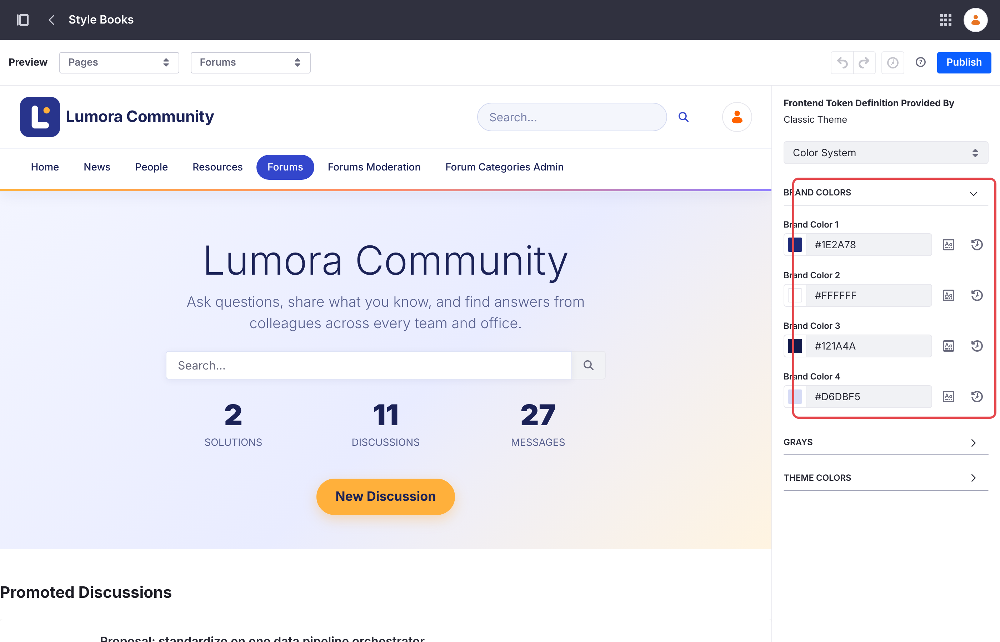
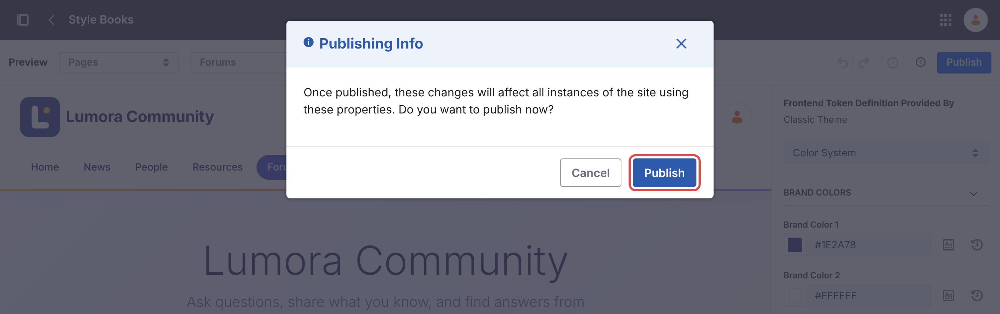
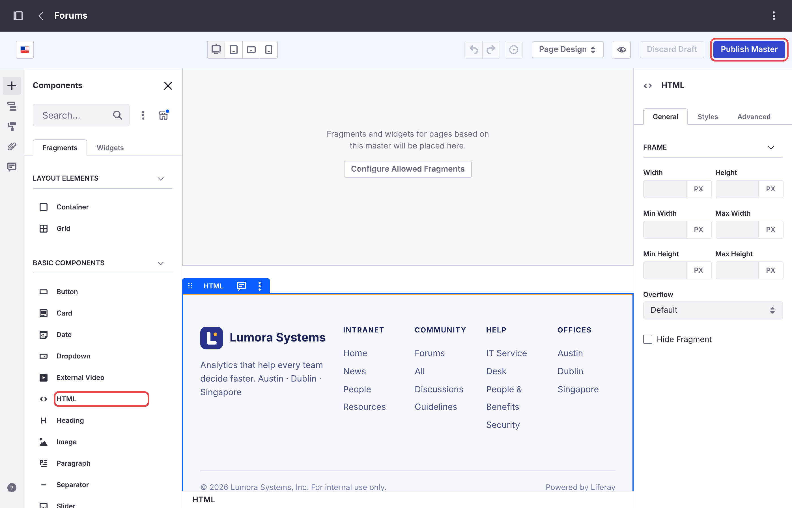
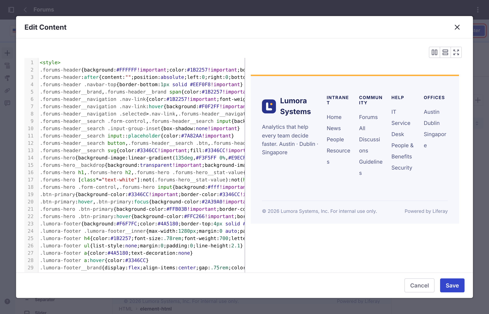

# Customizing the Forum
{: .no_toc }

The forum is an ordinary Liferay site, built with fragments, so you can change it with Liferay's site-building tools.

1. TOC
{:toc}

## Look and Feel

| Part | Where to Change It |
| --- | --- |
| Header and footer colors | *Design* → *Style Books* → **Forums**. **Brand Color 1** and **2** are the header's background and text, **3** and **4** the footer's. |
| Header and footer | *Design* → *Page Templates* → *Masters* → **Forums** |
| Logo | *Control Panel* → *Instance Settings* → *Instance Configuration* → *Appearance* → **Logo**. The header shows the instance's logo, next to the site's name. The logo is shared by every site that shows it. |
| Navigation links | *Site Builder* → *Pages*. **Liferay Learn** and **Help Center** are link pages you can edit or delete. For a company intranet, delete them or point them to your own help pages. |
| Home page title and description | Edit the home page and select the hero fragment. Change **Hero Title** and **Hero Description**. |

{: .note }
After you change a style book and click **Publish**, Liferay asks you to confirm in a **Publishing Info** dialog. Click its **Publish** too: until then, your changes stay in a draft and the site doesn't change.

{: .screenshot }

{: .screenshot }

## Matching Your Company's Look

The style book only changes a few colors, and the **Forums Footer** fragment shows a fixed line of text. To give the forum your company's header, colors, and footer, add your own styles and footer to the **Forums** master page. Every forum page uses it, so you do it once per forum site.

1. Go to *Design* → *Page Templates* → *Masters*, and open **Forums**.

1. From *Fragments and Widgets* → *Basic Components*, drag an **HTML** fragment onto the master page, below the content area, next to the **Forums Footer** fragment.

    {: .screenshot }

1. Double-click the HTML fragment to edit its code, and replace its content with a `<style>` block and your footer. For example, a light header with an indigo highlight for the current page, and a footer with your links:

    ```html
    <style>
    .forums-header{background:#FFFFFF!important;color:#1B2257!important;box-shadow:0 1px 0 #E6E9F5}
    .forums-header__brand,.forums-header__navigation .nav-link{color:#1B2257!important}
    .forums-header__navigation .nav-link{border-radius:999px}
    .forums-header__navigation .selected>.nav-link{background:#3346CC!important;color:#FFFFFF!important}
    .forums-hero{background-image:linear-gradient(135deg,#F3F5FF,#FFF4E1)!important}
    .forums-hero__backdrop{background:transparent!important}
    .forums-hero h1,.forums-hero .forums-hero__stat-value{color:#1B2257!important}
    .forums-hero p,.forums-hero figcaption{color:#5A6290!important}
    .btn-primary{background-color:#3346CC!important;border-color:#3346CC!important}
    .company-footer{background:#F6F7FC;border-top:4px solid #FFB03B;padding:3rem 2rem;color:#4A5180}
    .forums-footer{display:none}
    </style>
    <footer class="company-footer">
      <a href="/web/intranet">Intranet</a> · <a href="/web/intranet/help">Help</a>
      <p>© Your Company. For internal use only.</p>
    </footer>
    ```

    The last rule hides the **Forums Footer** fragment. You can delete that fragment from the master page instead. Click **Save**: the editor shows a preview of your footer next to the code.

    {: .screenshot }

1. Click **Publish Master**.

| To Change | Style These Classes |
| --- | --- |
| The header | `.forums-header`, with `.forums-header__brand` for the logo and site name, and `.forums-header__search` for the search box |
| The navigation links | `.forums-header__navigation .nav-link`, and `.selected>.nav-link` for the current page |
| The home page's hero | `.forums-hero`. Its `.forums-hero__backdrop` paints a dark overlay: make it transparent for a light hero, and set the hero's text colors, as in the example. |
| The buttons | `.btn-primary` |
| The original footer | `.forums-footer` |

{: .tip }
If your company's existing Liferay site uses its own master page, use the same styles and footer there, so that moving between the two sites looks seamless. To link the two sites' navigation, see [An Existing Site](several-sites.html#an-existing-site).

{: .warning }
These class names come from the forum's fragments and may change in a later release. After an upgrade, check the forum's header, home page, and footer.

## Promoted Discussions

The home page shows up to five **Promoted Discussions**, newest first. To promote a topic, add the tag `promoted` to it. To pick topics by hand instead, create a manual collection in *Site Builder* → *Collections*, and select it in the home page's **Promoted Discussions** collection display.

## Page and List Settings

Each forum fragment has settings, such as the number of topics per page or whether the home page shows statistics. Edit the page, select the fragment, and open its configuration. See the [Configuration Reference](../reference/configuration.html).

## Error Pages

A forum site uses Liferay's default 404 and 500 pages, without the forum's header and footer. To brand them, create a utility page that uses the **Forums** master page in *Site Builder* → *Pages* → *Utility Pages*, and mark it as the default for its error.

{: .note }
Your changes to a forum site are kept: a site initializer only sets up a site when it creates it, and never changes an existing site.

## Related Information

- [Configuration Reference](../reference/configuration.html)
- [Running Several Forum Sites](several-sites.html)
