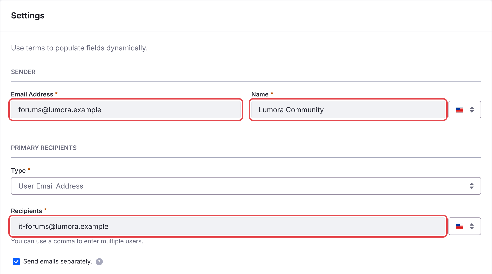

# Email Notifications

Liferay Forums emails members about replies to topics they follow and about mentions. Before it can send them, set the addresses they're sent from.

1. In *Applications* → *Notification Templates*, open **C2M0 Notification Email Reply** and set:
   - under **Sender**, **Email Address**: an address of a domain your site owns, for example `forums@example.com`;
   - under **Sender**, **Name**: the name members see, for example *Example Community*;
   - under **Primary Recipients**, **Recipients**: an address you own. Members are always added in BCC, so this address only gets a copy.

    Then click **Save**.

    {: .screenshot }

1. Do the same for **C2M0 Notification Email Mention**.

1. In *Control Panel* → *Instance Settings* → *Email* → *Email Sender*, set the address Liferay sends email from. Liferay sends no email without it.

1. Make sure Liferay's mail server is configured.

{: .warning }
Until you change them, the templates use the placeholder address `forums-noreply@example.xyz`. Mail servers reject or junk email from a domain you don't own.

{: .note }
The batch creates these two templates, and keeps your changes to them when it's deployed again. The microservice reads the templates when it starts, so restart it after changing them.

## Web Notifications

Members also get notifications in Liferay's notifications menu. They need no setup.

## Related Information

- [Subscriptions and Notifications](../using/subscriptions-and-notifications.html)
