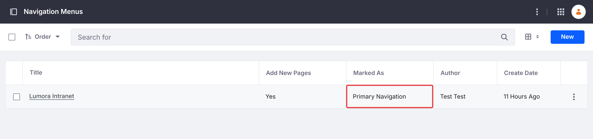
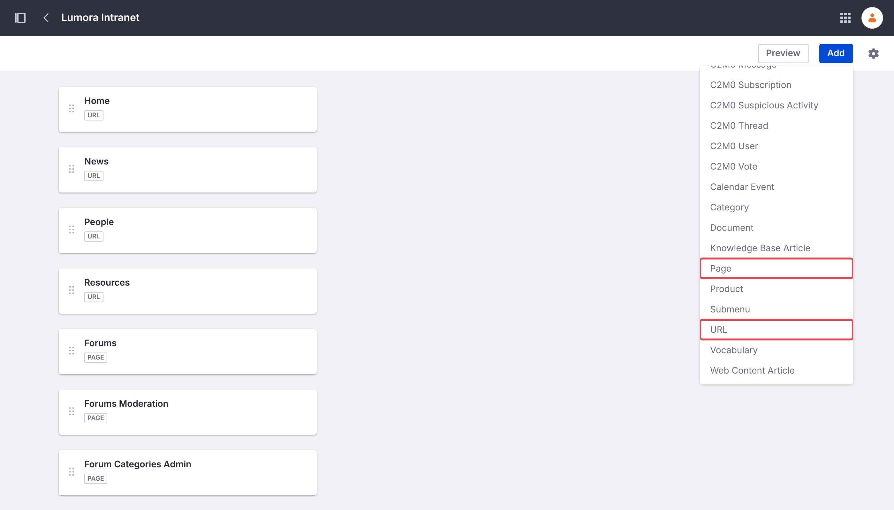
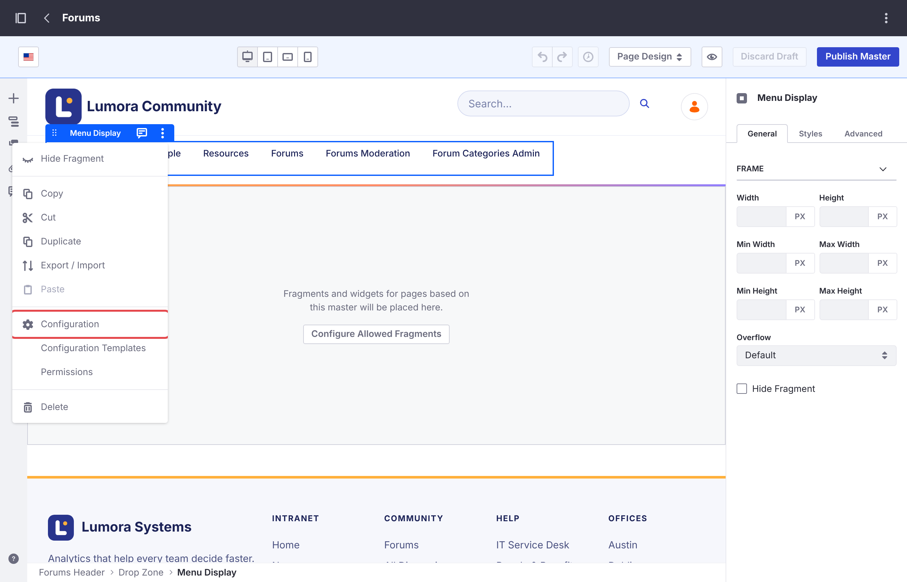
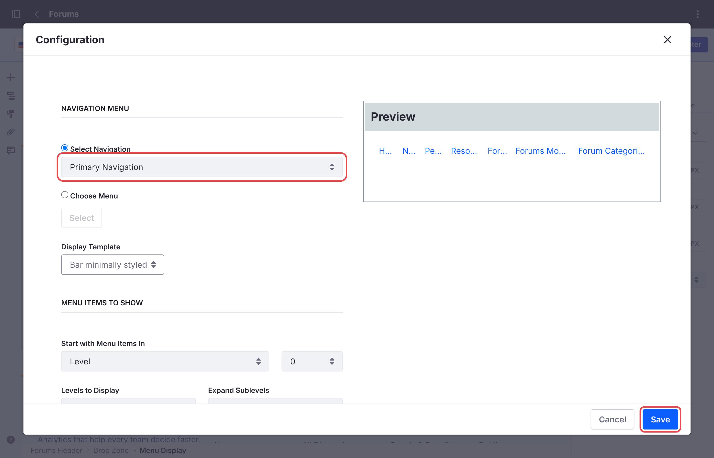

# Running Several Forum Sites

One Liferay instance can host several forum sites, for example one per product or region. Each site has its own categories, topics, search, and bans.

A site initializer creates one site, so each site needs its own. [Several Sites](../installing/creating-sites.html#several-sites) has the steps, for every install type. The batch and the microservice are shared by all forum sites and deployed once.

Liferay builds each site's address from its name: a site named *Acme* is served at `/web/acme`. To use another address, choose a different name, or change the site's friendly URL in *Site Settings* after it's created.

## Moderators and Category Admins

Bans apply to one site, but the **Forum Moderator** and **Forum Category Admin** roles apply to every forum site: a moderator of one forum site moderates them all. See [Roles and Permissions](../reference/roles-and-permissions.html).

## An Existing Site

The forum can't be added to a site that already exists, because Liferay sets up a site's forum pages only when it creates the site. Forum sites are always top-level sites: they can't be created as child sites of another. Create a forum site instead, and link the two sites to each other, so that members move between them as if they were one.

### Link to the Forum From the Existing Site

In the existing site, add a page of the type **Link to URL** in *Site Builder* → *Pages*, for example **Forums**, pointing to the forum site's address, such as `/web/forums`. It shows in the existing site's navigation like its other pages.

### Link Back From the Forum Site

The forum's header lists the forum site's own pages, so members who open the forum lose the existing site's navigation. Give the forum site a navigation menu with the existing site's pages first:

1. In the forum site, go to *Site Builder* → *Navigation Menus*, and add a menu, for example **Main**. In its settings, mark it as **Primary Navigation**.

    {: .screenshot }

1. Add the existing site's pages as **URL** items, in the order the existing site shows them, for example **Home** at `/web/intranet/home`, then **News** and **People**.

1. Add the forum's pages with **Add** → **Page**: **Forums**, then **Forums Moderation** and **Forum Categories Admin**. Page items keep their permissions, so members don't see the two moderator pages.

    {: .screenshot }

1. Go to *Design* → *Page Templates* → *Masters*, and open **Forums**. Click the header's menu to select its **Menu Display** widget, and choose **Configuration** from its options menu (⋮).

    {: .screenshot }

1. Set **Select Navigation** to **Primary Navigation**, and click **Save**. Then click **Publish Master**.

    {: .screenshot }

The forum's header now shows the existing site's pages, with **Forums** highlighted on the forum's home page. To match the two sites' look too, see [Matching Your Company's Look](customizing.html#matching-your-companys-look).

{: .note }
A **Link to URL** page in the forum site doesn't work for this: Liferay doesn't allow one as a site's first page, so the existing site's home page can't come first that way.

## Your Changes on Each Site

Each forum site has its own **Forums** master page, style book, and navigation menus. Changes to the look or the navigation of one forum site, as in [Customizing the Forum](customizing.html), have to be made again on each of the others.

## Deleting a Forum Site

See [Deleting a Forum Site](../installing/deleting.html). Other forum sites aren't affected.

## Related Information

- [Customizing the Forum](customizing.html)
- [Getting Started](../getting-started.html)
- [Banning Members](../moderating/banning.html)
