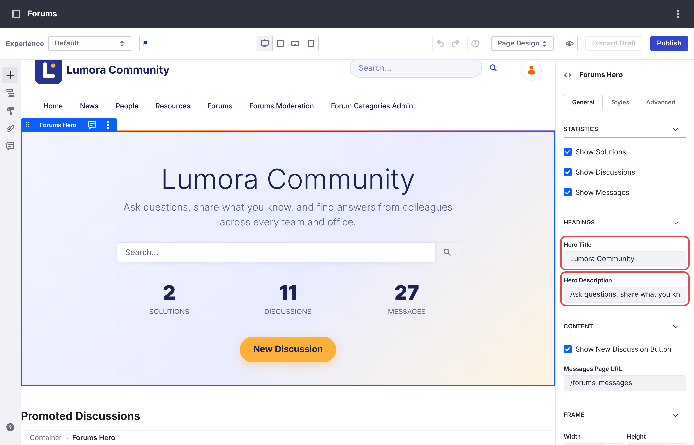
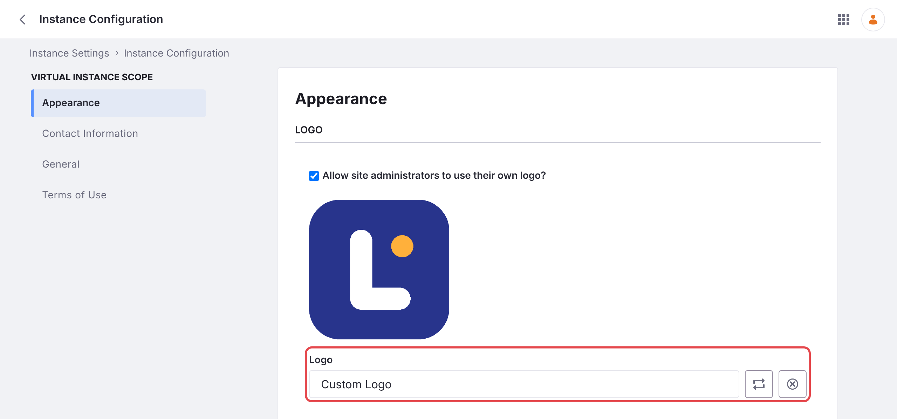
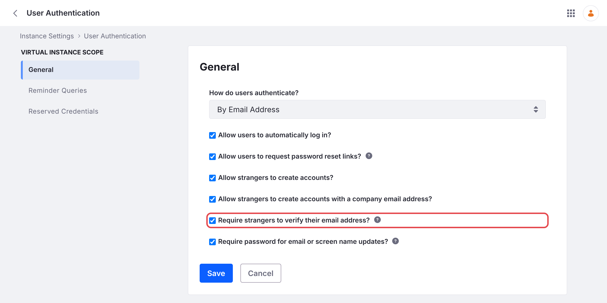
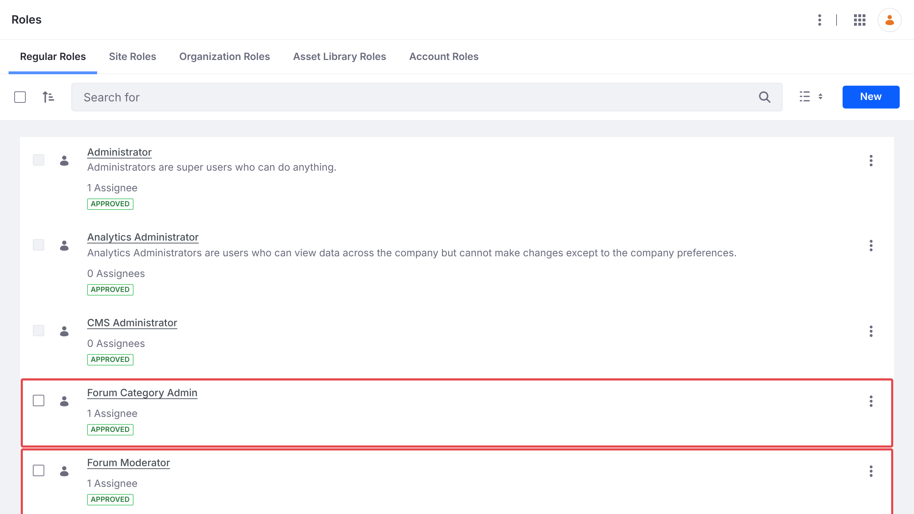
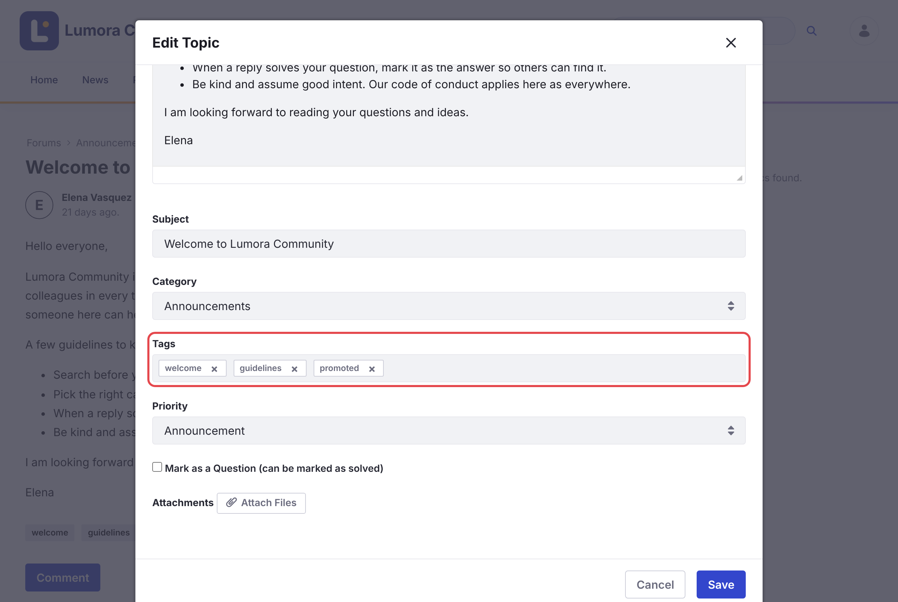

# Getting Started
{: .no_toc }

Liferay Forums adds a complete forum site to Liferay DXP. This page gets you from installing it to a forum members can use.

1. TOC
{:toc}

## Install

Liferay Forums 1.0.0 runs on Liferay DXP 2026.Q1 LTS with the [required Liferay fixes](installing/#required-liferay-fixes). [Installing](installing/) lists what it includes, and walks you through installing it on Liferay Self-Hosted (Tomcat or Docker), on Liferay PaaS, or on Liferay SaaS. When it finishes, the forum is available at `/web/forums`.

## First-Time Setup

After installing, complete these steps as an administrator. Members can start posting after the first one.

### Create Categories

Open **Forum Categories Admin**, and click **Seed Default Categories**, or add your own. Members can't post until at least one category exists. See [Managing Categories](administering/categories.html).

{: .screenshot }

### Name Your Forum

The home page's title says **Liferay Forums** until you change it.

1. Open the forum's home page, for example `/web/forums`, and click the pencil icon to edit it.
1. Click the hero, the banner at the top. In its **General** settings, under **Headings**, set **Hero Title** and **Hero Description**.
1. Click **Publish**.

{: .screenshot }

The site's name, shown in the header, is set in *Site Settings*. To rename the site, see [Running Several Forum Sites](administering/several-sites.html), because the name also sets its address.

### Replace the Liferay Links

The header links to **Liferay Learn** and **Help Center**, two link pages the site initializer adds. In *Site Builder* → *Pages*, delete them, or edit them to point to your own help pages.

### Add Your Logo

The header shows your Liferay instance's logo, next to the site's name. Set it in *Control Panel* → *Instance Settings* → *Instance Configuration* → *Appearance* → **Logo**, and click **Save**. Every site that shows the instance's logo shows the new one.

{: .screenshot }

To change the header's and footer's colors too, see [Customizing the Forum](administering/customizing.html).

### Set Up Email Notifications

Set the sender address of the forum's email templates and of your Liferay instance, then restart the microservice, which reads the templates only when it starts. See [Email Notifications](administering/email-notifications.html).

### Let Members Sign In

By default, Liferay asks every new account to verify its email address at its first sign-in, including accounts that you create or import. Until they do, members can't post.

- If members sign in with single sign-on, or you create their accounts for them, go to *Control Panel* → *Instance Settings* → *User Authentication*, clear **Require strangers to verify their email address?**, and click **Save**.
- Otherwise, keep it, and make sure Liferay can send email first, as in [Set Up Email Notifications](#set-up-email-notifications).

{: .screenshot }

### Assign Moderators

In *Control Panel* → *Users* → *Roles*, click **Forum Moderator**, open **Assignees** → **Users**, click **New**, and add the people who will moderate. Do the same for **Forum Category Admin**, for the people who will manage categories. Both roles apply to every forum site. See [Roles and Permissions](reference/roles-and-permissions.html).

{: .screenshot }

### Post a Welcome Topic and Promote It

1. Use **New Discussion** to post your community guidelines, as in [Starting a Discussion](using/starting-a-discussion.html).
1. As a moderator, open the topic, and choose **Options** → **Edit Topic**.
1. Add the tag `promoted`, set **Priority** to **Announcement**, and click **Save**.

{: .screenshot }

The home page's **Promoted Discussions** lists topics tagged `promoted`. Until at least one topic has that tag, it lists the most recently changed topics instead, whatever they are, so promote two or three topics, such as your guidelines and a how-to, before you announce the forum.

## Related Topics

- [Installing](installing/)
- [Starting a Discussion](using/starting-a-discussion.html)
- [Roles and Permissions](reference/roles-and-permissions.html)
- [Running Several Forum Sites](administering/several-sites.html)
