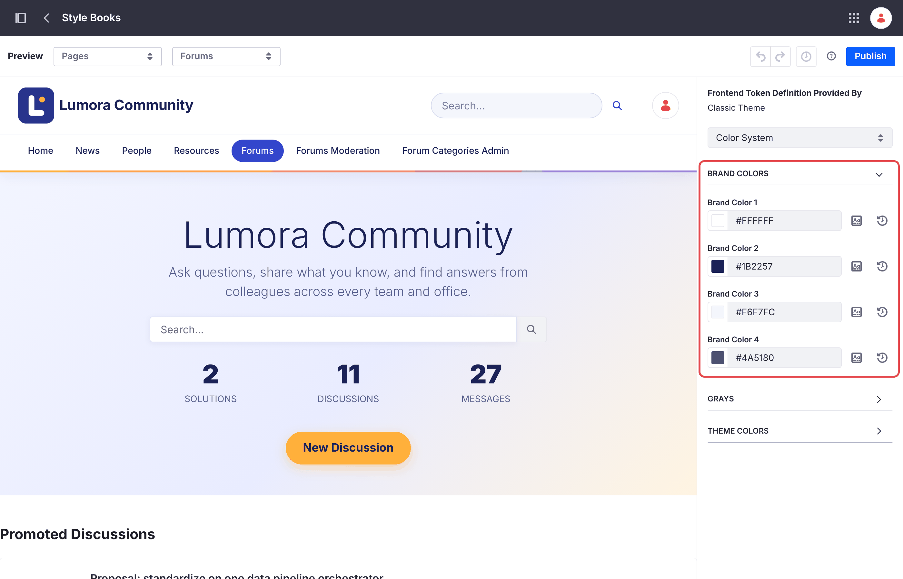
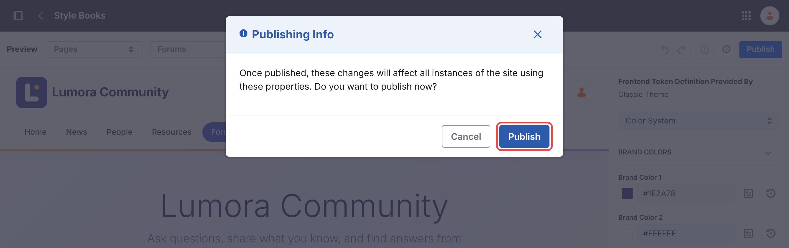
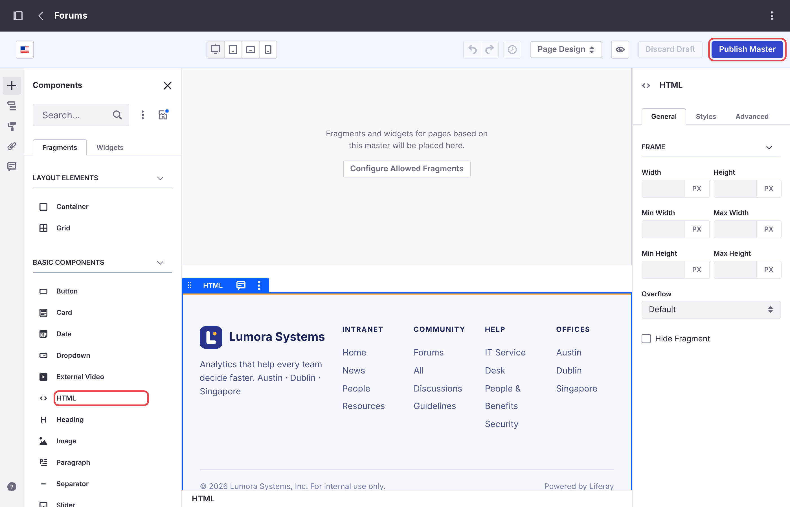
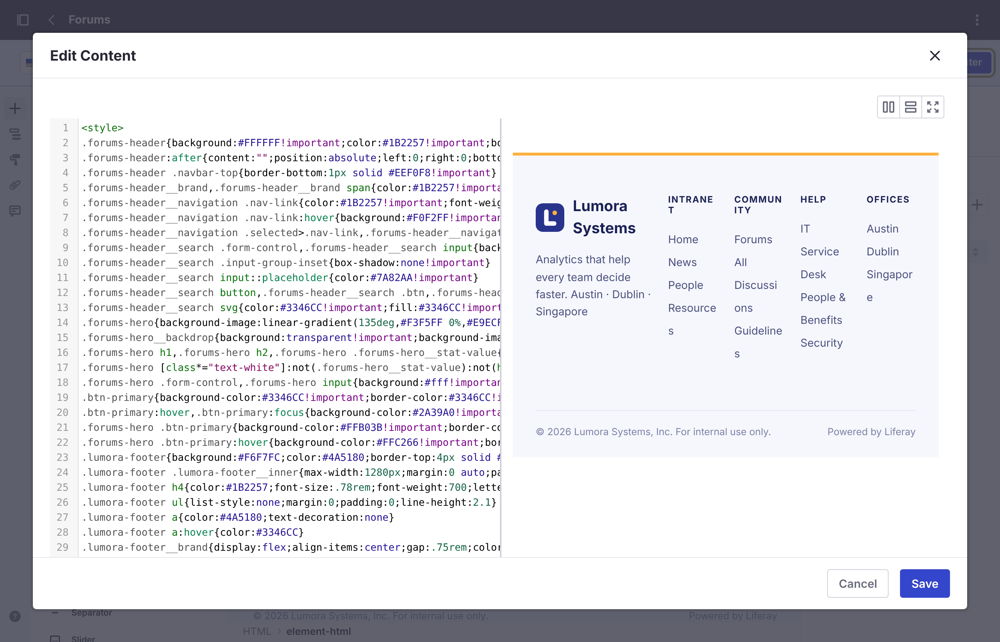

# Menyesuaikan Forum {#customizing-the-forum}
{: .no_toc }

Forum adalah situs Liferay biasa yang dibangun dengan fragment, sehingga Anda dapat mengubahnya dengan alat pembuatan situs Liferay.

1. TOC
{:toc}

## Tampilan {#look-and-feel}

| Bagian | Tempat Mengubahnya |
| --- | --- |
| Warna header dan footer | *Design* → *Style Books* → **Forums**. **Brand Color 1** dan **2** adalah latar belakang dan teks header, **3** dan **4** untuk footer. |
| Header dan footer | *Design* → *Page Templates* → *Masters* → **Forums** |
| Logo | *Control Panel* → *Instance Settings* → *Instance Configuration* → *Appearance* → **Logo**. Header menampilkan logo instance, di samping nama situs. Logo ini digunakan bersama oleh setiap situs yang menampilkannya. |
| Tautan navigasi | *Site Builder* → *Pages*. **Liferay Learn** dan **Help Center** adalah halaman tautan yang dapat Anda edit atau hapus. Untuk intranet perusahaan, hapus halaman tersebut atau arahkan ke halaman bantuan Anda sendiri. |
| Judul dan deskripsi halaman beranda | Edit halaman beranda dan pilih fragment hero. Ubah **Hero Title** dan **Hero Description**. |

{: .note }
Setelah Anda mengubah style book dan mengklik **Publish**, Liferay meminta Anda mengonfirmasi dalam dialog **Publishing Info**. Klik juga **Publish** di dialog tersebut: sampai saat itu, perubahan Anda tetap berupa draf dan situs tidak berubah.

{: .screenshot }

{: .screenshot }

## Menyesuaikan dengan Tampilan Perusahaan Anda {#matching-your-companys-look}

Style book hanya mengubah beberapa warna, dan fragment **Forums Footer** menampilkan satu baris teks yang tetap. Untuk memberi forum header, warna, dan footer perusahaan Anda, tambahkan style dan footer Anda sendiri ke master page **Forums**. Setiap halaman forum menggunakannya, jadi Anda cukup melakukannya sekali per situs forum.

1. Buka *Design* → *Page Templates* → *Masters*, lalu buka **Forums**.

1. Dari *Fragments and Widgets* → *Basic Components*, seret fragment **HTML** ke master page, di bawah area konten, di samping fragment **Forums Footer**.

    {: .screenshot }

1. Klik dua kali fragment HTML untuk mengedit kodenya, lalu ganti isinya dengan blok `<style>` dan footer Anda. Misalnya, header terang dengan sorotan indigo untuk halaman saat ini, dan footer dengan tautan Anda:

    ```html
    <style>
    .forums-header{background:#FFFFFF!important;color:#1B2257!important;box-shadow:0 1px 0 #E6E9F5}
    .forums-header__brand,.forums-header__navigation .nav-link{color:#1B2257!important}
    .forums-header__navigation .nav-link{border-radius:999px}
    .forums-header__navigation .selected>.nav-link{background:#3346CC!important;color:#FFFFFF!important}
    .forums-hero{background-image:linear-gradient(135deg,#F3F5FF,#FFF4E1)!important}
    .forums-hero__backdrop{background:transparent!important}
    .forums-hero h1,.forums-hero .forums-hero__stat-value{color:#1B2257!important}
    .forums-hero p,.forums-hero figcaption{color:#5A6290!important}
    .btn-primary{background-color:#3346CC!important;border-color:#3346CC!important}
    .company-footer{background:#F6F7FC;border-top:4px solid #FFB03B;padding:3rem 2rem;color:#4A5180}
    .forums-footer{display:none}
    </style>
    <footer class="company-footer">
      <a href="/web/intranet">Intranet</a> · <a href="/web/intranet/help">Help</a>
      <p>© Your Company. For internal use only.</p>
    </footer>
    ```

    Aturan terakhir menyembunyikan fragment **Forums Footer**. Sebagai gantinya, Anda dapat menghapus fragment tersebut dari master page. Klik **Save**: editor menampilkan pratinjau footer Anda di samping kode.

    {: .screenshot }

1. Klik **Publish Master**.

| Untuk Mengubah | Beri Style pada Class Ini |
| --- | --- |
| Header | `.forums-header`, dengan `.forums-header__brand` untuk logo dan nama situs, serta `.forums-header__search` untuk kotak pencarian |
| Tautan navigasi | `.forums-header__navigation .nav-link`, dan `.selected>.nav-link` untuk halaman saat ini |
| Hero halaman beranda | `.forums-hero`. `.forums-hero__backdrop` miliknya menampilkan lapisan gelap: buat transparan untuk hero yang terang, dan atur warna teks hero, seperti pada contoh. |
| Tombol | `.btn-primary` |
| Footer asli | `.forums-footer` |

{: .tip }
Jika situs Liferay perusahaan Anda yang sudah ada menggunakan master page-nya sendiri, gunakan style dan footer yang sama di sana, sehingga perpindahan antara kedua situs terlihat mulus. Untuk menautkan navigasi kedua situs, lihat [Situs yang Sudah Ada](several-sites.html#an-existing-site).

{: .warning }
Nama-nama class ini berasal dari fragment forum dan dapat berubah pada rilis berikutnya. Setelah upgrade, periksa header, halaman beranda, dan footer forum.

## Diskusi yang Dipromosikan {#promoted-discussions}

Halaman beranda menampilkan hingga lima **Promoted Discussions**, dimulai dari yang terbaru. Untuk mempromosikan topik, tambahkan tag `promoted` ke topik tersebut. Untuk memilih topik secara manual, buat collection manual di *Site Builder* → *Collections*, lalu pilih collection tersebut di collection display **Promoted Discussions** pada halaman beranda.

## Pengaturan Halaman dan Daftar {#page-and-list-settings}

Setiap fragment forum memiliki pengaturan, seperti jumlah topik per halaman atau apakah halaman beranda menampilkan statistik. Edit halaman, pilih fragment, lalu buka konfigurasinya. Lihat [Referensi Konfigurasi](../reference/configuration.html).

## Halaman Error {#error-pages}

Situs forum menggunakan halaman 404 dan 500 bawaan Liferay, tanpa header dan footer forum. Untuk memberinya branding, buat utility page yang menggunakan master page **Forums** di *Site Builder* → *Pages* → *Utility Pages*, lalu tandai sebagai halaman bawaan untuk error tersebut.

{: .note }
Perubahan Anda pada situs forum tetap dipertahankan: site initializer hanya menyiapkan situs saat membuatnya, dan tidak pernah mengubah situs yang sudah ada.

## Informasi Terkait {#related-information}

- [Referensi Konfigurasi](../reference/configuration.html)
- [Menjalankan Beberapa Situs Forum](several-sites.html)
