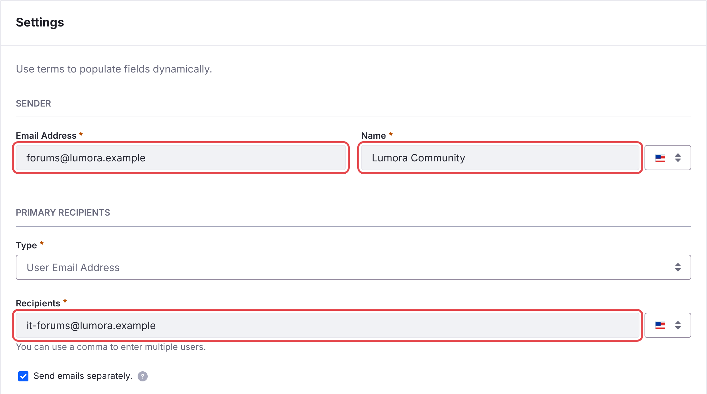

# Notifikasi Email {#email-notifications}

Liferay Forums mengirim email kepada anggota tentang balasan pada topik yang mereka ikuti dan tentang mention. Sebelum email tersebut dapat dikirim, atur alamat pengirimnya.

1. Di *Applications* → *Notification Templates*, buka **C2M0 Notification Email Reply** dan atur:
   - di bawah **Sender**, **Email Address**: alamat dari domain milik situs Anda, misalnya `forums@example.com`;
   - di bawah **Sender**, **Name**: nama yang dilihat anggota, misalnya *Example Community*;
   - di bawah **Primary Recipients**, **Recipients**: alamat milik Anda. Anggota selalu ditambahkan sebagai BCC, sehingga alamat ini hanya menerima salinan.

    Lalu klik **Save**.

    {: .screenshot }

1. Lakukan hal yang sama untuk **C2M0 Notification Email Mention**.

1. Di *Control Panel* → *Instance Settings* → *Email* → *Email Sender*, atur alamat yang digunakan Liferay untuk mengirim email. Tanpa alamat ini, Liferay tidak mengirim email apa pun.

1. Pastikan mail server Liferay sudah dikonfigurasi.

{: .warning }
Sampai Anda mengubahnya, template menggunakan alamat placeholder `forums-noreply@example.xyz`. Mail server menolak email dari domain yang bukan milik Anda atau memasukkannya ke folder junk.

{: .note }
Batch membuat kedua template ini, dan mempertahankan perubahan Anda pada template tersebut saat batch di-deploy lagi. Microservice membaca template saat dijalankan, jadi restart microservice setelah Anda mengubahnya.

## Notifikasi Web {#web-notifications}

Anggota juga menerima notifikasi di menu notifikasi Liferay. Notifikasi ini tidak memerlukan pengaturan.

## Informasi Terkait {#related-information}

- [Langganan dan Notifikasi](../using/subscriptions-and-notifications.html)
