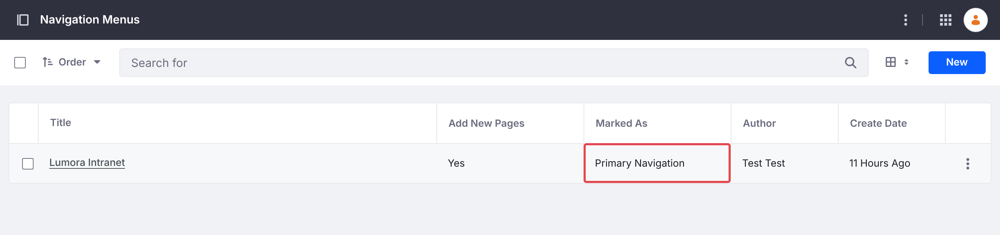
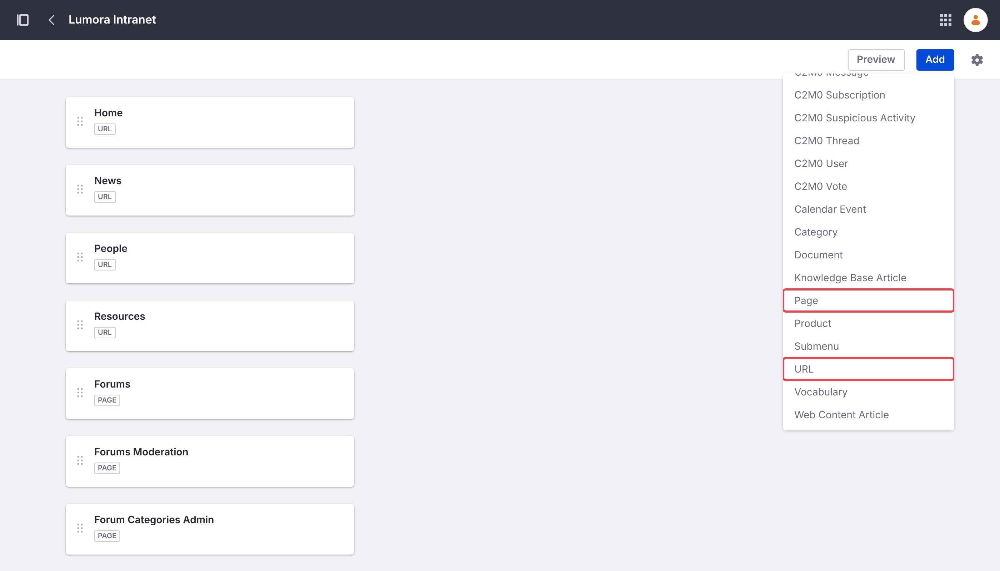
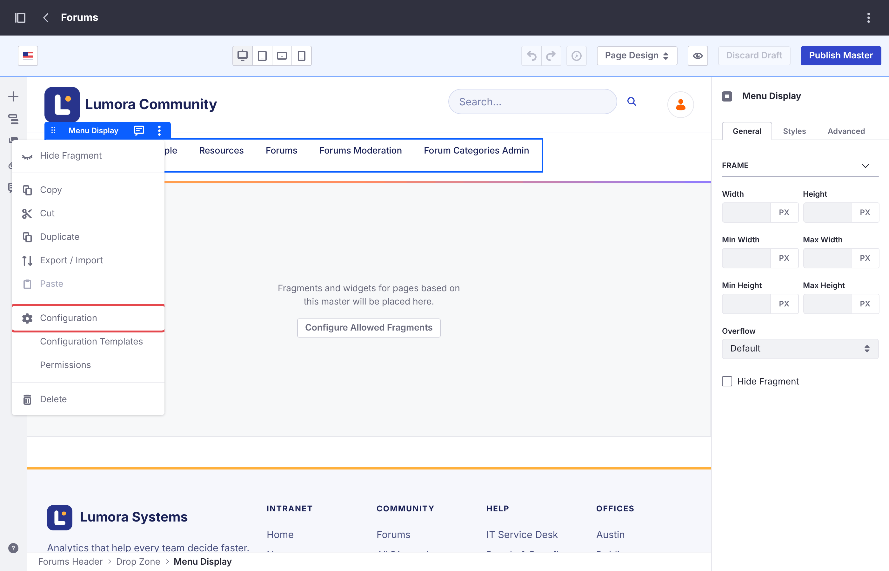
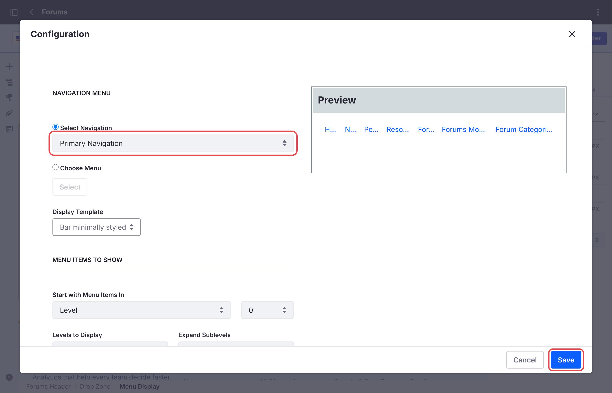

# Menjalankan Beberapa Situs Forum {#running-several-forum-sites}

Satu instance Liferay dapat menampung beberapa situs forum, misalnya satu per produk atau wilayah. Setiap situs memiliki kategori, topik, pencarian, dan blokir (ban) sendiri.

Satu site initializer membuat satu situs, sehingga setiap situs memerlukan site initializer-nya sendiri. [Beberapa Situs](../installing/creating-sites.html#several-sites) berisi langkah-langkahnya, untuk setiap jenis instalasi. Batch dan microservice digunakan bersama oleh semua situs forum dan cukup di-deploy sekali.

Liferay membentuk alamat setiap situs dari namanya: situs bernama *Acme* disajikan di `/web/acme`. Untuk menggunakan alamat lain, pilih nama yang berbeda, atau ubah friendly URL situs di *Site Settings* setelah situs dibuat.

## Moderator dan Admin Kategori {#moderators-and-category-admins}

Ban berlaku untuk satu situs, tetapi role **Forum Moderator** dan **Forum Category Admin** berlaku untuk setiap situs forum: moderator dari satu situs forum memoderasi semuanya. Lihat [Role dan Izin](../reference/roles-and-permissions.html).

## Situs yang Sudah Ada {#an-existing-site}

Forum tidak dapat ditambahkan ke situs yang sudah ada, karena Liferay menyiapkan halaman forum suatu situs hanya saat membuat situs tersebut. Situs forum selalu merupakan situs tingkat atas: situs ini tidak dapat dibuat sebagai child site dari situs lain. Sebagai gantinya, buat situs forum, lalu tautkan kedua situs satu sama lain, sehingga anggota dapat berpindah di antara keduanya seolah-olah keduanya adalah satu situs.

### Menautkan ke Forum dari Situs yang Sudah Ada {#link-to-the-forum-from-the-existing-site}

Di situs yang sudah ada, tambahkan halaman berjenis **Link to URL** di *Site Builder* → *Pages*, misalnya **Forums**, yang mengarah ke alamat situs forum, seperti `/web/forums`. Halaman ini tampil di navigasi situs yang sudah ada seperti halaman-halaman lainnya.

### Menautkan Kembali dari Situs Forum {#link-back-from-the-forum-site}

Header forum mencantumkan halaman-halaman milik situs forum itu sendiri, sehingga anggota yang membuka forum kehilangan navigasi situs yang sudah ada. Berikan situs forum sebuah navigation menu dengan halaman-halaman situs yang sudah ada di urutan pertama:

1. Di situs forum, buka *Site Builder* → *Navigation Menus*, lalu tambahkan menu, misalnya **Main**. Di pengaturannya, tandai menu tersebut sebagai **Primary Navigation**.

    {: .screenshot }

1. Tambahkan halaman-halaman situs yang sudah ada sebagai item **URL**, sesuai urutan yang ditampilkan situs tersebut, misalnya **Home** di `/web/intranet/home`, lalu **News** dan **People**.

1. Tambahkan halaman-halaman forum dengan **Add** → **Page**: **Forums**, lalu **Forums Moderation** dan **Forum Categories Admin**. Item halaman mempertahankan izinnya, sehingga anggota tidak melihat kedua halaman moderator tersebut.

    {: .screenshot }

1. Buka *Design* → *Page Templates* → *Masters*, lalu buka **Forums**. Klik menu header untuk memilih widget **Menu Display**-nya, lalu pilih **Configuration** dari menu opsinya (⋮).

    {: .screenshot }

1. Atur **Select Navigation** ke **Primary Navigation**, lalu klik **Save**. Kemudian klik **Publish Master**.

    {: .screenshot }

Header forum sekarang menampilkan halaman-halaman situs yang sudah ada, dengan **Forums** disorot di halaman beranda forum. Untuk menyamakan juga tampilan kedua situs, lihat [Menyesuaikan dengan Tampilan Perusahaan Anda](customizing.html#matching-your-companys-look).

{: .note }
Halaman **Link to URL** di situs forum tidak dapat digunakan untuk keperluan ini: Liferay tidak mengizinkannya sebagai halaman pertama situs, sehingga halaman beranda situs yang sudah ada tidak dapat ditempatkan di urutan pertama dengan cara itu.

## Perubahan Anda di Setiap Situs {#your-changes-on-each-site}

Setiap situs forum memiliki master page **Forums**, style book, dan navigation menu sendiri. Perubahan pada tampilan atau navigasi satu situs forum, seperti dalam [Menyesuaikan Forum](customizing.html), harus dilakukan lagi di setiap situs lainnya.

## Menghapus Situs Forum {#deleting-a-forum-site}

Lihat [Menghapus Situs Forum](../installing/deleting.html). Situs forum lainnya tidak terpengaruh.

## Informasi Terkait {#related-information}

- [Menyesuaikan Forum](customizing.html)
- [Memulai](../getting-started.html)
- [Memblokir Anggota](../moderating/banning.html)
