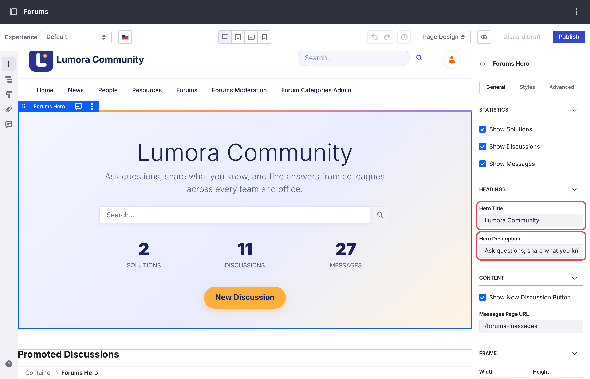
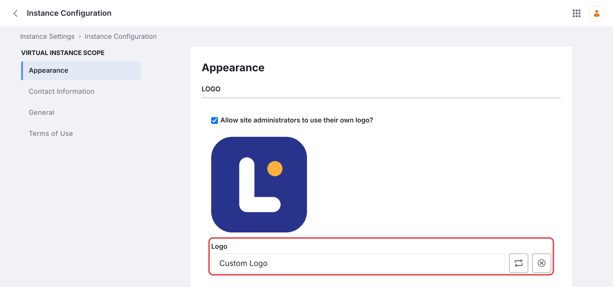
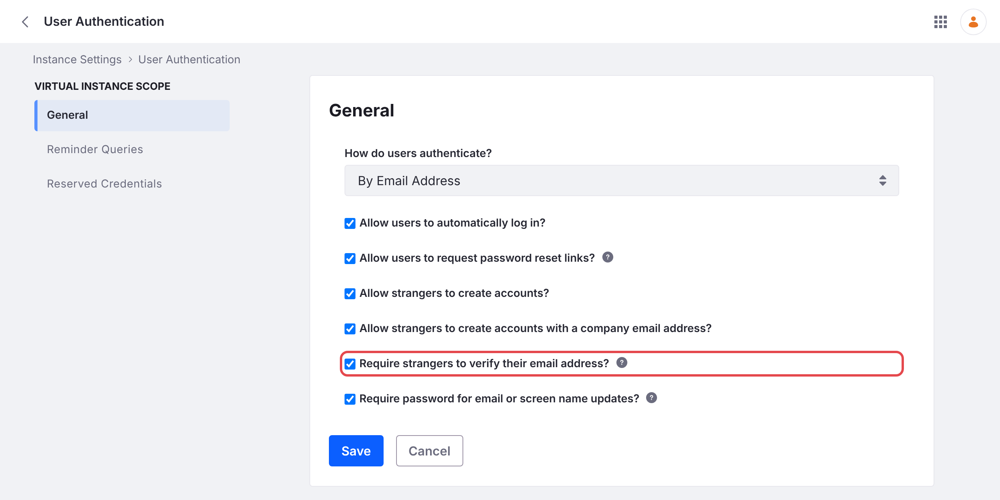
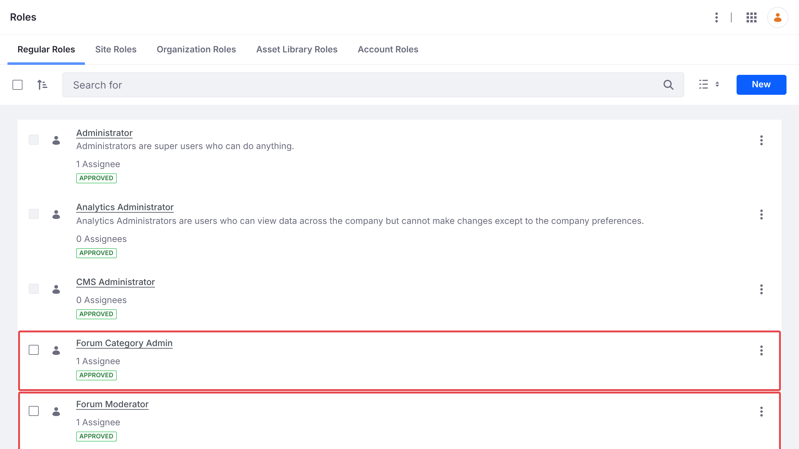
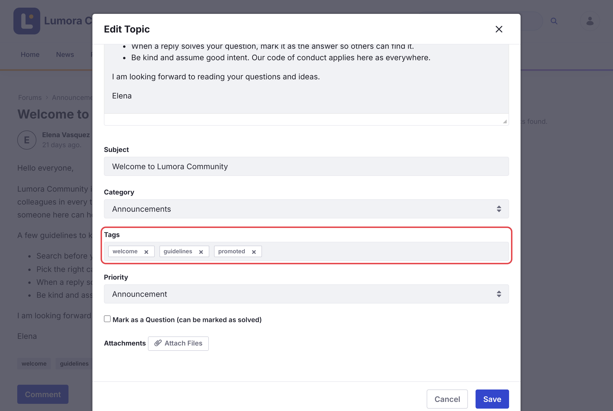

# Memulai {#getting-started}
{: .no_toc }

Liferay Forums menambahkan situs forum yang lengkap ke Liferay DXP. Halaman ini memandu Anda dari instalasi hingga forum yang dapat digunakan anggota.

1. TOC
{:toc}

## Instalasi {#install}

Liferay Forums 1.0.0 berjalan di Liferay DXP 2026.Q1 LTS dengan [perbaikan Liferay yang diperlukan](installing/#required-liferay-fixes). [Instalasi](installing/) mencantumkan isi Liferay Forums, dan memandu Anda menginstalnya di Liferay Self-Hosted (Tomcat atau Docker), di Liferay PaaS, atau di Liferay SaaS. Setelah selesai, forum tersedia di `/web/forums`.

## Penyiapan Pertama Kali {#first-time-setup}

Setelah instalasi, selesaikan langkah-langkah berikut sebagai administrator. Anggota dapat mulai memposting setelah langkah pertama.

### Buat Kategori {#create-categories}

Buka **Forum Categories Admin**, lalu klik **Seed Default Categories**, atau tambahkan kategori Anda sendiri. Anggota tidak dapat memposting sampai setidaknya ada satu kategori. Lihat [Mengelola Kategori](administering/categories.html).

{: .screenshot }

### Beri Nama Forum Anda {#name-your-forum}

Judul halaman beranda menampilkan **Liferay Forums** sampai Anda mengubahnya.

1. Buka halaman beranda forum, misalnya `/web/forums`, lalu klik ikon pensil untuk mengeditnya.
1. Klik hero, yaitu banner di bagian atas. Di pengaturan **General**-nya, di bawah **Headings**, atur **Hero Title** dan **Hero Description**.
1. Klik **Publish**.

{: .screenshot }

Nama situs, yang ditampilkan di header, diatur di *Site Settings*. Untuk mengganti nama situs, lihat [Menjalankan Beberapa Situs Forum](administering/several-sites.html), karena nama tersebut juga menentukan alamatnya.

### Ganti Tautan Liferay {#replace-the-liferay-links}

Header menautkan ke **Liferay Learn** dan **Help Center**, dua halaman tautan yang ditambahkan oleh site initializer. Di *Site Builder* → *Pages*, hapus halaman tersebut, atau edit agar mengarah ke halaman bantuan Anda sendiri.

### Tambahkan Logo Anda {#add-your-logo}

Header menampilkan logo instance Liferay Anda, di samping nama situs. Atur logo di *Control Panel* → *Instance Settings* → *Instance Configuration* → *Appearance* → **Logo**, lalu klik **Save**. Setiap situs yang menampilkan logo instance akan menampilkan logo yang baru.

{: .screenshot }

Untuk mengubah warna header dan footer juga, lihat [Menyesuaikan Forum](administering/customizing.html).

### Siapkan Notifikasi Email {#set-up-email-notifications}

Atur alamat pengirim templat email forum dan instance Liferay Anda, lalu mulai ulang microservice, yang hanya membaca templat saat dimulai. Lihat [Notifikasi Email](administering/email-notifications.html).

### Izinkan Anggota Masuk {#let-members-sign-in}

Secara default, Liferay meminta setiap akun baru memverifikasi alamat emailnya saat pertama kali masuk, termasuk akun yang Anda buat atau impor. Sampai verifikasi dilakukan, anggota tidak dapat memposting.

- Jika anggota masuk dengan single sign-on, atau Anda membuatkan akun mereka, buka *Control Panel* → *Instance Settings* → *User Authentication*, kosongkan **Require strangers to verify their email address?**, lalu klik **Save**.
- Jika tidak, biarkan pengaturan tersebut, dan pastikan terlebih dahulu bahwa Liferay dapat mengirim email, seperti pada [Siapkan Notifikasi Email](#set-up-email-notifications).

{: .screenshot }

### Tetapkan Moderator {#assign-moderators}

Di *Control Panel* → *Users* → *Roles*, klik **Forum Moderator**, buka **Assignees** → **Users**, klik **New**, lalu tambahkan orang-orang yang akan menjadi moderator. Lakukan hal yang sama untuk **Forum Category Admin**, bagi orang-orang yang akan mengelola kategori. Kedua peran berlaku untuk setiap situs forum. Lihat [Peran dan Izin](reference/roles-and-permissions.html).

{: .screenshot }

### Posting Topik Sambutan dan Promosikan {#post-a-welcome-topic-and-promote-it}

1. Gunakan **New Discussion** untuk memposting pedoman komunitas Anda, seperti pada [Memulai Diskusi](using/starting-a-discussion.html).
1. Sebagai moderator, buka topik tersebut, lalu pilih **Options** → **Edit Topic**.
1. Tambahkan tag `promoted`, atur **Priority** ke **Announcement**, lalu klik **Save**.

{: .screenshot }

**Promoted Discussions** di halaman beranda mencantumkan topik yang diberi tag `promoted`. Sampai setidaknya satu topik memiliki tag tersebut, bagian ini mencantumkan topik yang paling baru diubah, apa pun topiknya. Jadi, promosikan dua atau tiga topik, seperti pedoman Anda dan sebuah panduan cara, sebelum Anda mengumumkan forum.

## Topik Terkait {#related-topics}

- [Instalasi](installing/)
- [Memulai Diskusi](using/starting-a-discussion.html)
- [Role dan Izin](reference/roles-and-permissions.html)
- [Menjalankan Beberapa Situs Forum](administering/several-sites.html)
