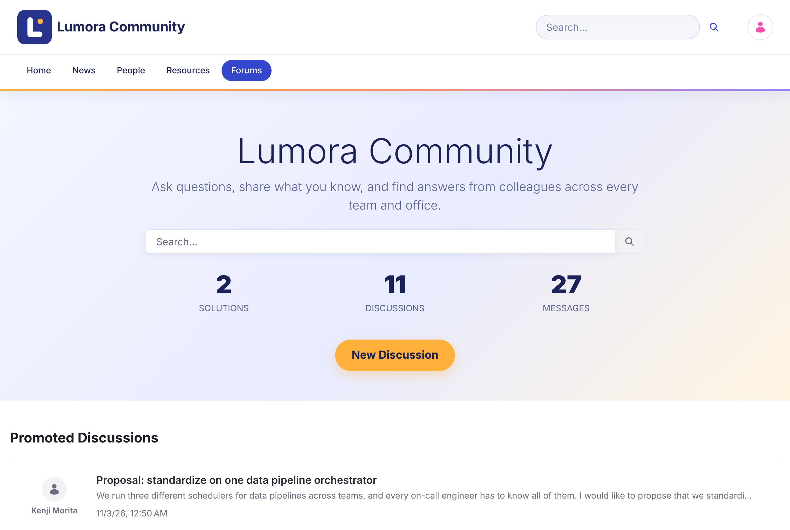

# Liferay Forums {#liferay-forums}
{: .no_toc }

Forum diskusi modern untuk Liferay DXP. Anggota mengajukan pertanyaan, berbagi jawaban, dan mengikuti percakapan yang mereka minati, sementara moderator menjaga komunitas tetap sehat.

{: .screenshot }

  <a class="card doc" href="getting-started.html"><strong>Memulai</strong>Isi Liferay Forums dan cara menyiapkan situs forum pertama Anda.</a>
  <a class="card doc" href="installing/"><strong>Instalasi</strong>Instalasi langkah demi langkah di Liferay Self-Hosted (Tomcat atau Docker), atau di Liferay PaaS atau SaaS.</a>
  <a class="card doc" href="using/"><strong>Menggunakan Forum</strong>Memulai diskusi, membalas, mengajukan pertanyaan, memberi suara, dan mengikuti topik.</a>
  <a class="card doc" href="moderating/"><strong>Moderasi</strong>Mengunci topik, meninjau laporan, dan memblokir anggota yang melanggar aturan.</a>
  <a class="card doc" href="administering/"><strong>Administrasi</strong>Mengelola kategori, notifikasi email, tampilan situs, dan beberapa situs forum.</a>
  <a class="card doc" href="reference/"><strong>Referensi</strong>Peran dan izin, halaman, konfigurasi, dan masalah yang diketahui.</a>

## Sorotan {#highlights}

- **Diskusi dan pertanyaan.** Posting topik sebagai diskusi terbuka, atau sebagai pertanyaan yang dapat ditandai sebagai terselesaikan.
- **Kategori.** Atur topik ke dalam kategori dan satu tingkat subkategori.
- **Mention dan langganan.** Sebut (mention) anggota dengan `@`, dan dapatkan notifikasi web dan email untuk topik yang Anda ikuti.
- **Pemberian suara.** Beri suara naik (upvote) atau suara turun (downvote) pada topik dan balasan.
- **Moderasi.** Anggota melaporkan konten. Moderator memvalidasi laporan, mengunci topik, menghapus topik, dan memblokir penulis per situs.
- **Pencarian.** Temukan topik dengan facet untuk kategori, tag, penulis, dan tanggal.
- **Beberapa situs.** Jalankan forum terpisah, masing-masing dengan kategori, topik, dan pemblokirannya sendiri.
- **13 bahasa.** Label tersedia dalam bahasa Inggris, Arab, Katalan, Tionghoa, Belanda, Finlandia, Prancis, Jerman, Hongaria, Jepang, Portugis (Brasil), Spanyol, dan Swedia.

## Versi yang Didukung {#supported-versions}

| Liferay Forums | Liferay DXP |
| --- | --- |
| [1.0.0](https://github.com/Liferay-Community-APAC/liferay-forums/releases/tag/v1.0.0) | 2026.Q1 LTS, dengan [perbaikan Liferay yang diperlukan](installing/#required-liferay-fixes). Diuji pada 2026.Q1.1 dan 2026.Q1.4. |

Untuk menginstal Liferay Forums, ikuti [Instalasi](installing/). Unduh file rilis dari [rilis terbaru](https://github.com/Liferay-Community-APAC/liferay-forums/releases/latest).

## Resep Solusi {#solution-recipes}

Resep menunjukkan langkah demi langkah cara menggabungkan Liferay Forums dengan produk Liferay lainnya. Resep tersedia di situs Liferay Community APAC (dalam bahasa Inggris).

  <a class="card doc" href="https://liferay-community-apac.github.io/solution-recipes/forums-ai-assistant/"><strong>Forums Assistant with AI Hub</strong>Tambahkan obrolan AI yang memberi tahu anggota di mana diskusi yang mereka cari, dengan hanya mencari konten yang dapat dilihat setiap anggota. Menggunakan Liferay AI Hub, yang tersedia secara umum (GA) sejak Liferay DXP 2026.Q3.</a>

  
  
<strong>Didukung oleh Liferay AI Hub.</strong> Dengan Liferay AI Hub, Anda dapat menjalankan agen AI yang belajar, mengambil keputusan, dan meningkatkan pengalaman digital Anda, tanpa hambatan teknis. <a href="https://www.liferay.com/capabilities/ai-hub">Pelajari Liferay AI Hub (dalam bahasa Inggris)</a>

