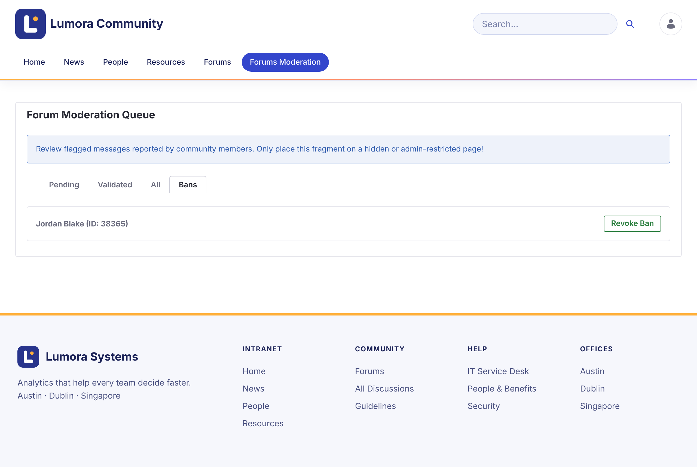

# Memblokir Anggota {#banning-members}

Anggota yang diblokir masih dapat membaca forum, tetapi tidak dapat memulai topik atau membalas. Postingan mereka yang sudah ada tetap ada. Saat mencoba memposting, mereka melihat **Your account has been banned from participating in the forums.**

## Memblokir Anggota {#banning-a-member}

1. Di antrean moderasi, buka tab **Validated**.

1. Pada laporan tentang topik anggota tersebut, klik **Ban Author**.

1. Konfirmasikan.

Anggota tersebut tercantum di tab **Bans**.

{: .screenshot }

Pemblokiran berlaku untuk satu situs. Anggota yang diblokir di satu situs forum masih dapat memposting di situs lain.

{: .note }
Pemblokiran adalah peran situs **Forum Banned**. Administrator juga dapat menetapkannya kepada anggota di keanggotaan situs.

## Mencabut Pemblokiran {#lifting-a-ban}

Di tab **Bans**, klik **Revoke Ban** di samping anggota tersebut.

## Informasi Terkait {#related-information}

- [Meninjau Laporan](reviewing-reports.html)
- [Role dan Izin](../reference/roles-and-permissions.html)