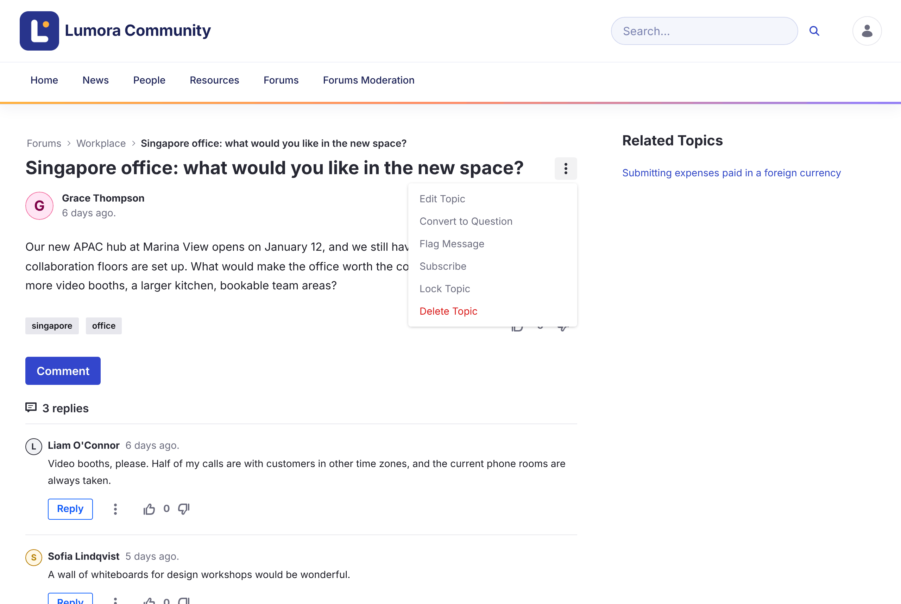

# Moderasi {#moderating}

Moderator menjaga agar diskusi tetap sesuai topik dan menindaklanjuti laporan dari komunitas.

{: .important }
Moderasi memerlukan peran **Forum Moderator**, atau peran **Administrator** Liferay. Moderator melihat halaman **Forums Moderation** di navigasi forum, serta tindakan moderasi di menu **Options** setiap topik. Lihat [Peran dan Izin](../reference/roles-and-permissions.html).

{: .screenshot }

  <a class="card doc" href="locking.html"><strong>Mengunci Topik</strong>Hentikan balasan dan pengeditan baru pada sebuah topik.</a>
  <a class="card doc" href="priority.html"><strong>Menyematkan Topik dengan Prioritas</strong>Pertahankan pengumuman dan topik penting di bagian atas.</a>
  <a class="card doc" href="reviewing-reports.html"><strong>Meninjau Laporan</strong>Validasi atau abaikan laporan dari anggota.</a>
  <a class="card doc" href="banning.html"><strong>Memblokir Anggota</strong>Cegah anggota memposting di sebuah situs.</a>

