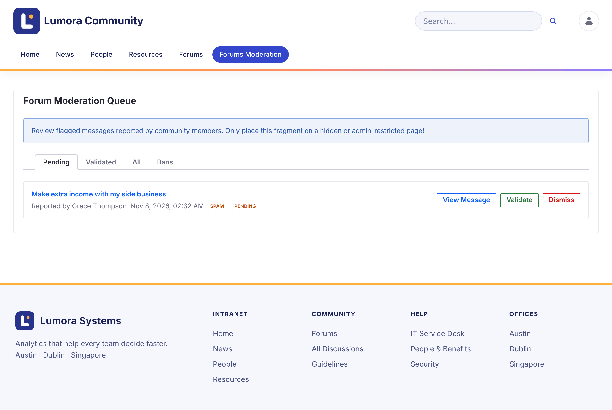
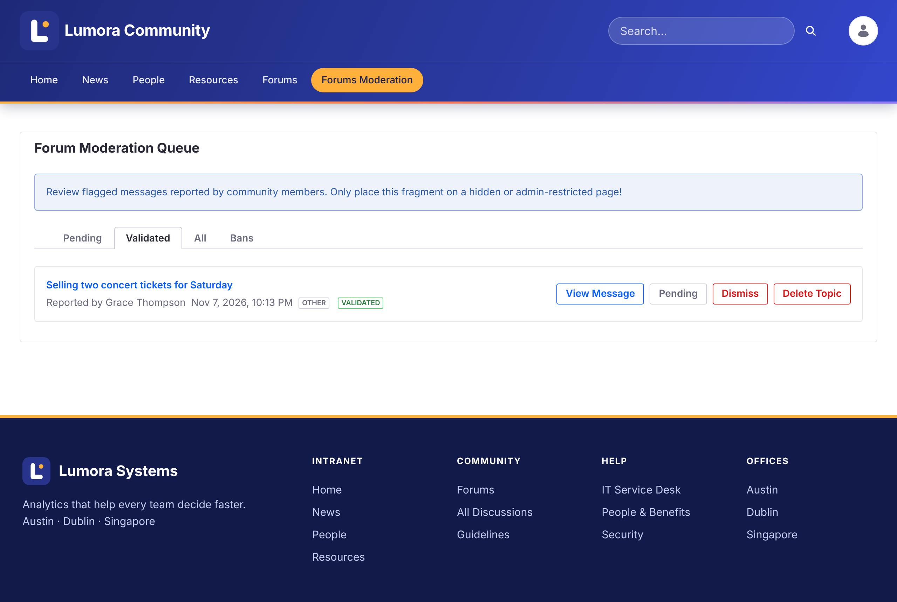

# Meninjau Laporan {#reviewing-reports}
{: .no_toc }

Saat anggota [melaporkan](../using/reporting.html) sebuah topik, laporan tersebut muncul di antrean moderasi.

1. TOC
{:toc}

## Antrean Moderasi {#the-moderation-queue}

Buka **Forums Moderation** di navigasi forum. **Forum Moderation Queue** memiliki empat tab:

| Tab | Menampilkan |
| --- | --- |
| **Pending** | Laporan baru untuk ditinjau |
| **Validated** | Laporan yang dikonfirmasi moderator |
| **All** | Semua laporan |
| **Bans** | Anggota yang diblokir di situs ini |

Setiap laporan menampilkan topik, siapa yang melaporkannya, kapan, dan alasannya.

{: .screenshot }

## Menindaklanjuti Laporan {#acting-on-a-report}

- **View Message** membuka topik agar Anda dapat membacanya dalam konteks.
- **Validate** mengonfirmasi laporan. Semua laporan tertunda lainnya pada topik yang sama juga divalidasi. Topik mendapatkan lencana **Flagged** dan pemberitahuan bahwa topik tersebut ditandai sebagai tidak pantas.
- **Dismiss** menghapus laporan dan membiarkan topik apa adanya.

Laporan yang sudah divalidasi menawarkan tindakan lainnya:

- **Pending** memindahkan laporan kembali ke Pending, jika laporan tersebut tervalidasi secara tidak sengaja.
- **Ban Author** memblokir penulis topik dari situs ini. Lihat [Memblokir Anggota](banning.html).
- **Delete Topic** menghapus topik beserta semua balasan, laporan, dan langganannya.

{: .screenshot }

{: .warning }
Penghapusan topik tidak dapat dibatalkan.

## Informasi Terkait {#related-information}

- [Memblokir Anggota](banning.html)
- [Mengunci Topik](locking.html)
