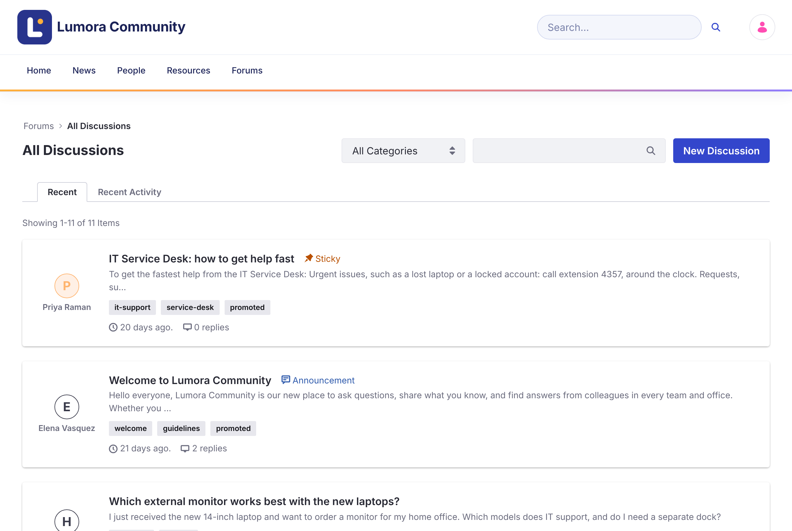
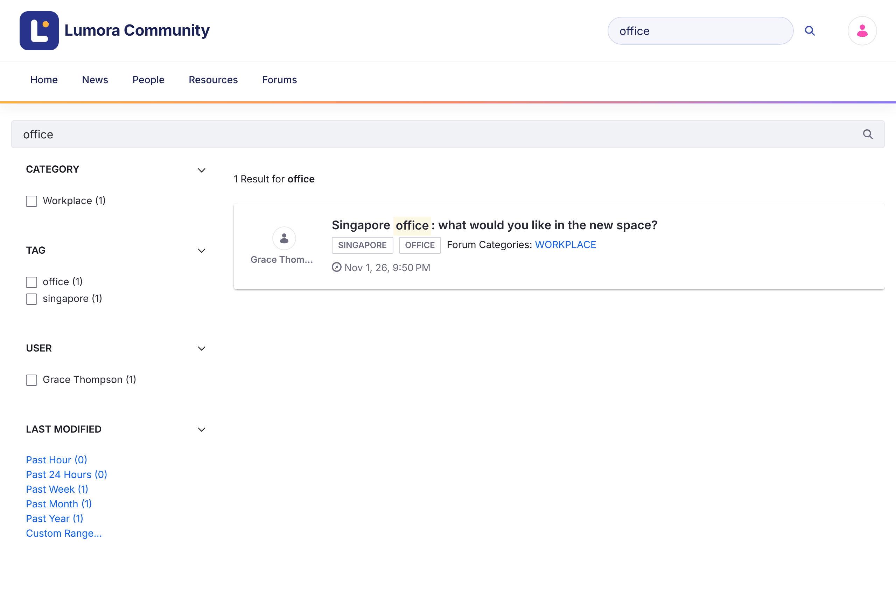

# Menjelajah dan Mencari {#browsing-and-searching}
{: .no_toc }

1. TOC
{:toc}

## Halaman Beranda Forum {#the-forum-home-page}

Halaman beranda (`/web/forums`) menampilkan statistik komunitas (solusi, diskusi, dan pesan), bilah pencarian, **Promoted Discussions** yang dipilih oleh tim komunitas, dan kisi kategori. Klik kategori untuk melihat topiknya.

## Semua Diskusi {#all-discussions}

Daftar diskusi menampilkan setiap topik, atau topik dari satu kategori.

{: .screenshot }

- **Recent** mengurutkan topik berdasarkan waktu pembuatannya. **Recent Activity** mengurutkannya berdasarkan balasan terbarunya.
- Topik dengan prioritas (**Urgent**, **Sticky**, atau **Announcement**) selalu muncul pertama.
- Gunakan menu **All Categories** untuk menampilkan satu kategori dan subkategorinya.
- Gunakan kotak pencarian untuk memfilter daftar berdasarkan kata kunci, atau klik tag untuk menampilkan topik dengan tag tersebut.
- Lencana menunjukkan status topik: **Solved**, **Locked**, **Flagged**, dan prioritasnya.

## Pencarian {#search}

Bilah pencarian di header dan di halaman beranda mencari topik forum. Halaman hasil memiliki facet untuk mempersempit hasil berdasarkan **Category**, **Tag**, **User**, dan tanggal **Modified**.

{: .screenshot }

Pencarian hanya mencakup topik dari situs forum saat ini.

## Topik Terkait {#related-topics}

Halaman topik mencantumkan **Related Topics**: topik lain dalam kategori yang sama, dengan aktivitas terbaru lebih dulu.

## Informasi Terkait {#related-information}

- [Memulai Diskusi](starting-a-discussion.html)
- [Mengelola Kategori](../administering/categories.html)
- [Forums Assistant with AI Hub](https://liferay-community-apac.github.io/solution-recipes/forums-ai-assistant/), resep solusi (dalam bahasa Inggris)
- [AI Discussion Summaries with AI Hub](https://liferay-community-apac.github.io/solution-recipes/forums-ai-summaries/), resep solusi (dalam bahasa Inggris)
- [Liferay AI Hub](https://www.liferay.com/capabilities/ai-hub), halaman produk resmi (dalam bahasa Inggris)
