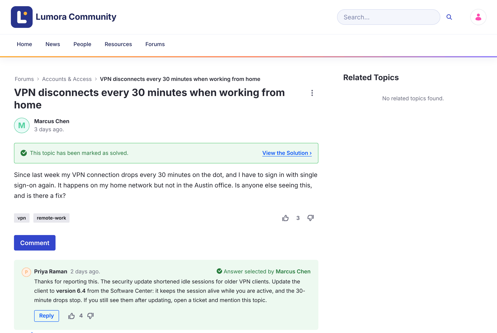

# Pertanyaan dan Jawaban {#questions-and-answers}

Topik yang diposting sebagai pertanyaan dapat ditandai sebagai terselesaikan dengan menerima satu balasan sebagai jawabannya.

{: .screenshot }

## Menandai Jawaban {#marking-the-answer}

1. Buka pertanyaan tersebut.

1. Di bawah balasan yang menyelesaikannya, klik **Mark as Answer**.

Balasan menampilkan **Accepted**, topik menampilkan **This topic has been marked as solved.** dengan tautan **View the Solution**, dan topik mendapatkan lencana **Solved** di daftar. Halaman beranda menghitungnya di bawah **Solutions**.

- Hanya satu balasan yang dapat menjadi jawaban yang diterima. Untuk memilih balasan lain, klik **Accepted** untuk menghapusnya terlebih dahulu.
- Hanya balasan tingkat atas yang dapat diterima, bukan balasan atas balasan.
- Moderator dapat menandai dan menghapus jawaban.

{: .important }
Di Liferay Forums 1.0.0, penulis pertanyaan juga melihat **Mark as Answer**, tetapi belum dapat menggunakannya. Lihat [Masalah yang Diketahui](../reference/known-issues.html).

## Informasi Terkait {#related-information}

- [Memulai Diskusi](starting-a-discussion.html)
- [Pemberian Suara](voting.html)
