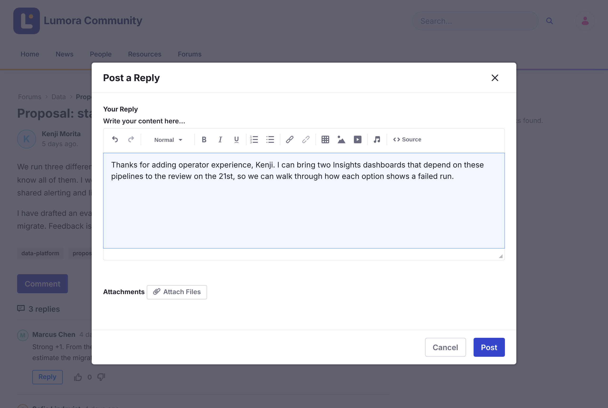

# Membalas dan Mention {#replying-and-mentions}
{: .no_toc }

1. TOC
{:toc}

## Membalas Topik {#replying-to-a-topic}

1. Buka topik tersebut.

1. Klik **Comment** untuk membalas topik, atau **Reply** di bawah sebuah balasan untuk menjawabnya secara langsung.

1. Tulis balasan Anda di **Your Reply**, dan jika perlu, klik **Attach Files**.

1. Klik **Post**.

{: .screenshot }

Balasan atas sebuah balasan ditampilkan bersarang di bawahnya. Percakapan yang panjang dibagi menjadi beberapa halaman.

Untuk mengubah atau menghapus balasan Anda, buka menu **Options** (⋮) balasan tersebut, lalu klik **Edit Reply** atau **Delete Reply**.

{: .note }
Anda tidak dapat membalas topik yang [dikunci](../moderating/locking.html).

## Menyebut Seseorang {#mentioning-someone}

Ketik `@` diikuti awal sebuah nama, lalu pilih orang tersebut dari daftar. Mereka akan mendapatkan notifikasi di Liferay dan melalui email.

- Daftar menampilkan orang-orang yang sudah pernah memposting di forum ini.
- Jika seseorang sudah mendapatkan notifikasi tentang balasan Anda karena mereka mengikuti topik tersebut, mereka tidak mendapatkan notifikasi kedua untuk mention tersebut.
- Saat Anda mengedit balasan, hanya mention yang baru ditambahkan yang diberi notifikasi.

## Informasi Terkait {#related-information}

- [Langganan dan Notifikasi](subscriptions-and-notifications.html)
- [Pemberian Suara](voting.html)
