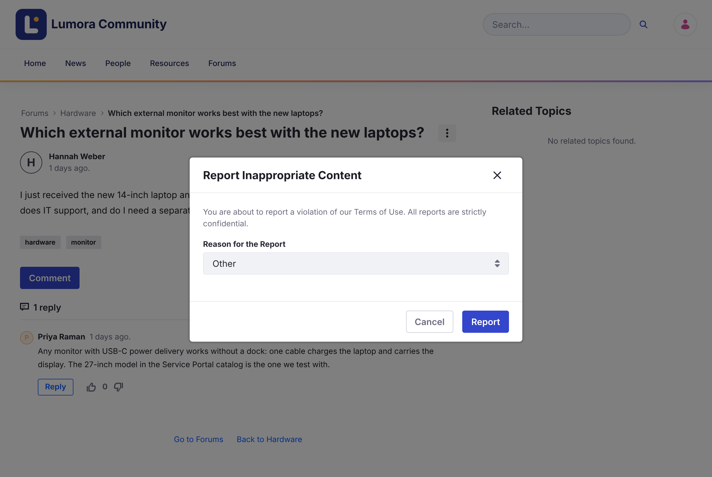

# Melaporkan Konten {#reporting-content}

Jika sebuah topik melanggar aturan komunitas, laporkan topik tersebut agar moderator dapat meninjaunya.

1. Buka topik tersebut.

1. Buka menu **Options** (⋮) topik, lalu klik **Flag Message**.

1. Pilih **Reason for the Report**: **Spam**, **Harmful Dangerous Acts**, **Harassment or Bullying**, **Nudity or Sexual Content**, atau **Other**.

1. Klik **Report**.

{: .screenshot }

Laporan bersifat rahasia: hanya moderator yang dapat melihat siapa yang melaporkan sebuah topik. Anda dapat melaporkan sebuah topik satu kali.

Saat moderator mengonfirmasi laporan, topik menampilkan **This message has been flagged and validated as inappropriate content.**

## Informasi Terkait {#related-information}

- [Meninjau Laporan](../moderating/reviewing-reports.html)
