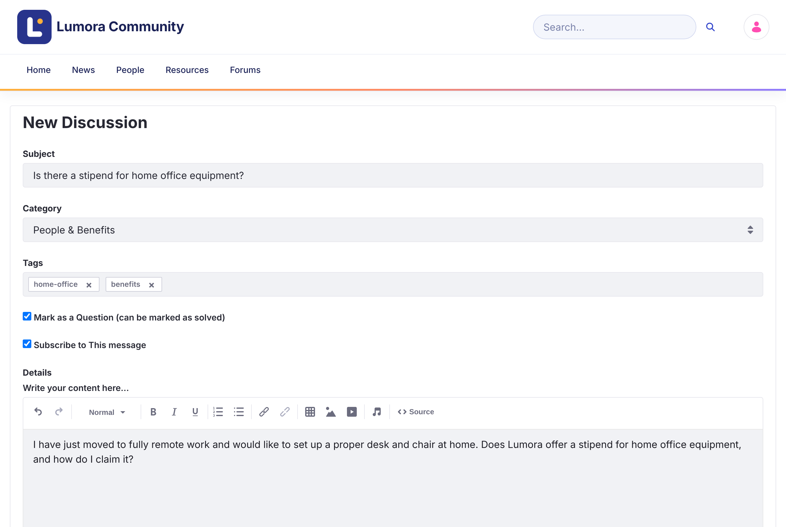

# Memulai Diskusi {#starting-a-discussion}

Sebuah topik memulai percakapan dalam satu kategori. Anda dapat mempostingnya sebagai diskusi terbuka atau sebagai pertanyaan.

{: .important }
Anda harus masuk untuk memulai diskusi. Anggota yang [diblokir](../moderating/banning.html) tidak dapat memposting.

1. Klik **New Discussion** di halaman beranda atau di atas daftar diskusi.

1. Masukkan **Subject** yang menjelaskan topik.

1. Pilih **Category**.

1. Jika perlu, tambahkan **Tags** untuk membantu orang lain menemukan topik tersebut.

1. Biarkan **Mark as a Question (can be marked as solved)** dicentang jika Anda meminta bantuan. Kosongkan untuk diskusi terbuka. Anda dapat mengubahnya nanti.

1. Biarkan **Subscribe to This message** dicentang untuk mendapatkan notifikasi tentang balasan.

1. Tulis topik di **Details**. Anda dapat memformat teks, menambahkan tautan, tabel, gambar, dan video, serta [menyebut](replying.html#mentioning-someone) anggota lain.

1. Jika perlu, klik **Attach Files**. Setiap file dapat berukuran hingga 10 MB.

1. Klik **Post**.

{: .screenshot }

Topik terbuka setelah diposting.

{: .note }
Moderator juga melihat kolom **Priority**: **Announcement**, **Sticky**, atau **Urgent**. Lihat [Menyematkan Topik dengan Prioritas](../moderating/priority.html).

## Mengedit atau Menghapus Topik Anda {#editing-or-deleting-your-topic}

Buka menu **Options** (⋮) topik, lalu klik **Edit Topic** atau **Delete Topic**. Dari menu yang sama, **Convert to Question** dan **Convert to Discussion** mengubah topik di antara kedua jenis tersebut.

{: .warning }
Mengonversi pertanyaan menjadi diskusi akan menghapus jawaban yang diterimanya.

## Informasi Terkait {#related-information}

- [Pertanyaan dan Jawaban](questions-and-answers.html)
- [Membalas dan Mention](replying.html)
