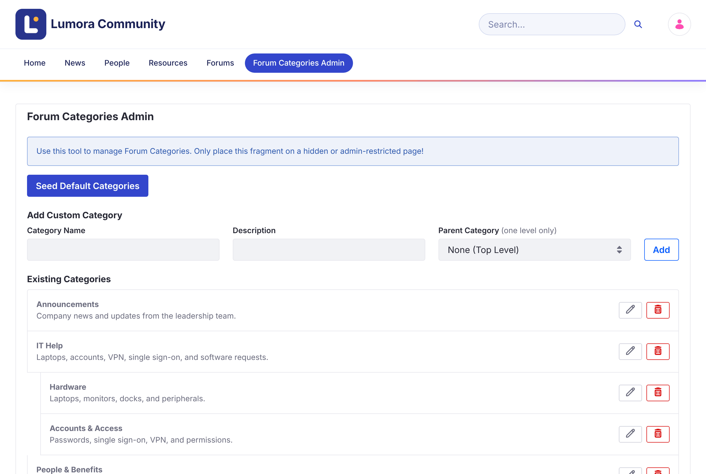

# カテゴリーの管理 {#managing-categories}
{: .no_toc }

すべてのトピックはいずれかのカテゴリーに属します。新しいフォーラムサイトにはカテゴリーがないため、メンバーが投稿を始める前に作成してください。

{: .important }
カテゴリーの管理には、**Forum Category Admin** ロール、または Liferay の **Administrator** ロールが必要です。これらのロールを持つユーザーには、フォーラムのナビゲーションに **Forum Categories Admin** が表示されます。

1. TOC
{:toc}

{: .screenshot }

## デフォルトのカテゴリーを追加する {#adding-the-default-categories}

**Seed Default Categories** をクリックすると、4 つの初期カテゴリー（**General Discussion**、**Technical Help**、**Feature Requests**、**Best Practices**）が追加されます。必要に応じて編集または削除してください。

## カテゴリーを追加する {#adding-a-category}

1. **Add Custom Category** で、**Category Name** と、必要に応じて **Description** を入力します。

1. サブカテゴリーにするには、その **Parent Category** を選択します。トップレベルのカテゴリーにする場合は、**None (Top Level)** のままにします。

1. **Add** をクリックします。

サブカテゴリーは 1 階層までです。サブカテゴリーを持つカテゴリーは、トップレベルのままになります。

## カテゴリーを編集または削除する {#editing-or-deleting-a-category}

カテゴリーの横にある **Edit**（鉛筆）ボタンと **Delete**（ゴミ箱）ボタンを使用します。

{: .warning }
カテゴリーを削除すると、そのサブカテゴリーも削除されます。それらのトピックは削除されず、カテゴリーが外れて **All Discussions** に表示されたままになります。この操作は元に戻せません。

{: .note }
カテゴリーはサイトの **Forum Categories** ボキャブラリーに属する Liferay のカテゴリーなので、*Site Menu* → *Categorization* → *Categories* でも管理できます。

## 関連情報 {#related-information}

- [閲覧と検索](../using/browsing-and-searching.html)
- [設定リファレンス](../reference/configuration.html)
