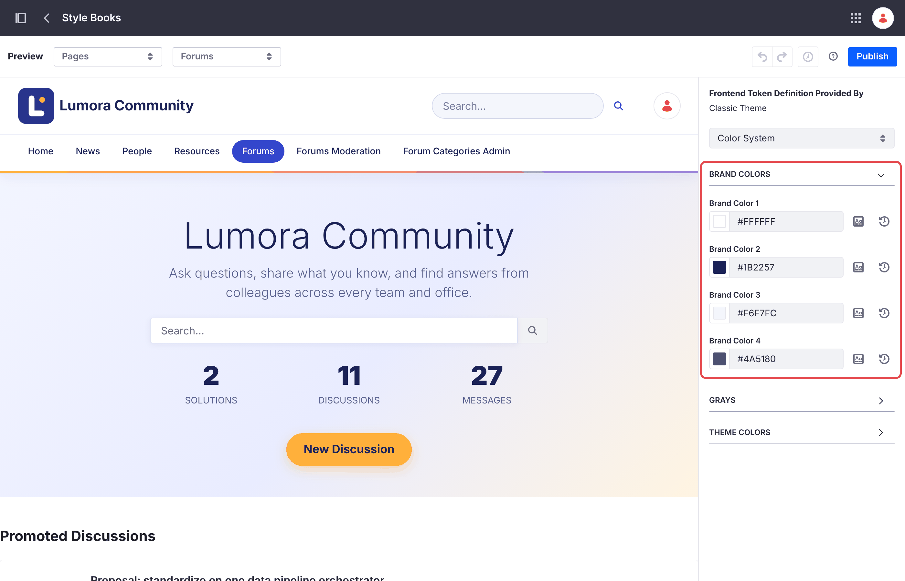
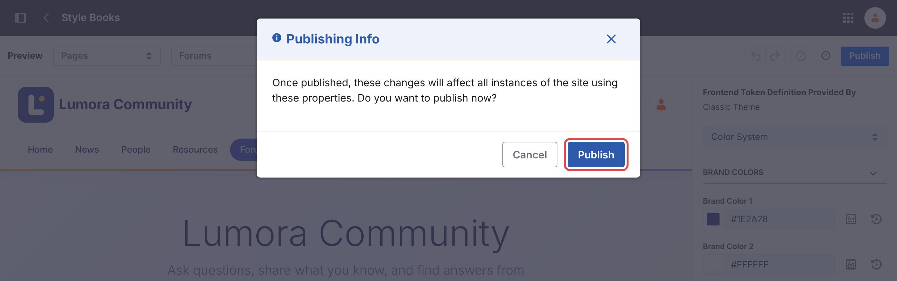
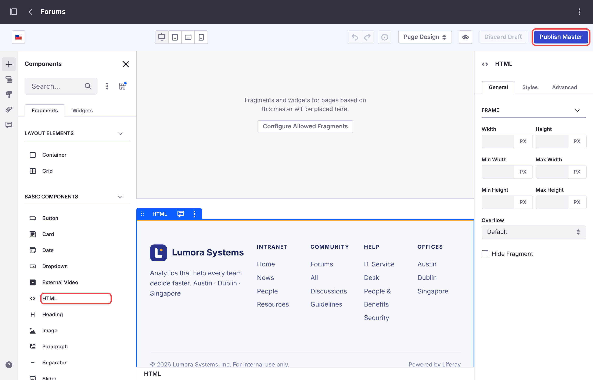
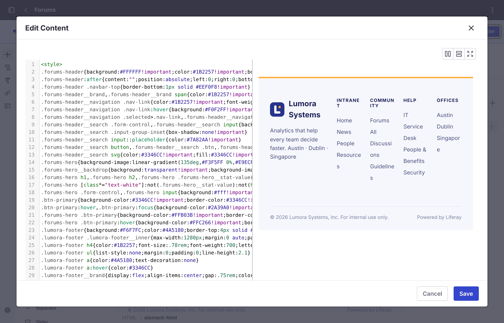

# フォーラムのカスタマイズ {#customizing-the-forum}
{: .no_toc }

フォーラムはフラグメントで構築された通常の Liferay サイトなので、Liferay のサイト構築ツールで変更できます。

1. TOC
{:toc}

## ルック・アンド・フィール {#look-and-feel}

| 部分 | 変更する場所 |
| --- | --- |
| ヘッダーとフッターの色 | *Design* → *Style Books* → **Forums**。**Brand Color 1** と **2** はヘッダーの背景色と文字色、**3** と **4** はフッターの背景色と文字色です。 |
| ヘッダーとフッター | *Design* → *Page Templates* → *Masters* → **Forums** |
| ロゴ | *Control Panel* → *Instance Settings* → *Instance Configuration* → *Appearance* → **Logo**。ヘッダーには、サイト名の横にインスタンスのロゴが表示されます。このロゴは、それを表示するすべてのサイトで共有されます。 |
| ナビゲーションリンク | *Site Builder* → *Pages*。**Liferay Learn** と **Help Center** は、編集や削除ができるリンクページです。社内イントラネットの場合は、これらを削除するか、自社のヘルプページを指すように変更してください。 |
| ホームページのタイトルと説明 | ホームページを編集し、ヒーローフラグメントを選択します。**Hero Title** と **Hero Description** を変更します。 |

{: .note }
スタイルブックを変更して **Publish** をクリックすると、Liferay は **Publishing Info** ダイアログで確認を求めます。このダイアログの **Publish** もクリックしてください。クリックするまで変更は下書きのままで、サイトには反映されません。

{: .screenshot }

{: .screenshot }

## 自社の外観に合わせる {#matching-your-companys-look}

スタイルブックで変更できるのは一部の色だけで、**Forums Footer** フラグメントには固定のテキストが 1 行表示されます。フォーラムに自社のヘッダー、色、フッターを適用するには、**Forums** マスターページに独自のスタイルとフッターを追加します。すべてのフォーラムページがこのマスターページを使用するため、この作業はフォーラムサイトごとに 1 回で済みます。

1. *Design* → *Page Templates* → *Masters* に移動し、**Forums** を開きます。

1. *Fragments and Widgets* → *Basic Components* から、**HTML** フラグメントをマスターページのコンテンツエリアの下、**Forums Footer** フラグメントの隣にドラッグします。

    {: .screenshot }

1. HTML フラグメントをダブルクリックしてコードを編集し、その内容を `<style>` ブロックと独自のフッターに置き換えます。たとえば、現在のページをインディゴで強調表示する明るいヘッダーと、自社のリンクを含むフッターは次のようになります。

    ```html
   
    ```

    

    最後のルールは **Forums Footer** フラグメントを非表示にします。代わりに、マスターページからそのフラグメントを削除してもかまいません。**Save** をクリックすると、エディターのコードの横にフッターのプレビューが表示されます。

    {: .screenshot }

1. **Publish Master** をクリックします。

| 変更する対象 | スタイルを設定するクラス |
| --- | --- |
| ヘッダー | `.forums-header`。ロゴとサイト名には `.forums-header__brand`、検索ボックスには `.forums-header__search` を使用します |
| ナビゲーションリンク | `.forums-header__navigation .nav-link`。現在のページには `.selected>.nav-link` を使用します |
| ホームページのヒーロー | `.forums-hero`。その `.forums-hero__backdrop` は暗いオーバーレイを描画します。明るいヒーローにするには、例のように、これを透明にしてヒーローの文字色を設定します。 |
| ボタン | `.btn-primary` |
| 元のフッター | `.forums-footer` |

{: .tip }
自社の既存の Liferay サイトが独自のマスターページを使用している場合は、そこにも同じスタイルとフッターを使用すると、2 つのサイト間をシームレスに行き来できるようになります。2 つのサイトのナビゲーションをつなぐには、[既存のサイト](several-sites.html#an-existing-site)を参照してください。

{: .warning }
これらのクラス名はフォーラムのフラグメントに由来するもので、今後のリリースで変更される可能性があります。アップグレード後は、フォーラムのヘッダー、ホームページ、フッターを確認してください。

## 注目のディスカッション {#promoted-discussions}

ホームページには、最大 5 件の **Promoted Discussions** が新しい順に表示されます。トピックを注目のディスカッションにするには、そのトピックに `promoted` タグを追加します。代わりにトピックを手動で選ぶには、*Site Builder* → *Collections* で手動コレクションを作成し、ホームページの **Promoted Discussions** コレクション表示でそのコレクションを選択します。

## ページと一覧の設定 {#page-and-list-settings}

各フォーラムフラグメントには、1 ページあたりのトピック数や、ホームページに統計情報を表示するかどうかなどの設定があります。ページを編集し、フラグメントを選択して、その設定を開きます。[設定リファレンス](../reference/configuration.html)を参照してください。

## エラーページ {#error-pages}

フォーラムサイトでは Liferay のデフォルトの 404 ページと 500 ページが使用され、フォーラムのヘッダーとフッターは表示されません。これらをブランディングするには、*Site Builder* → *Pages* → *Utility Pages* で **Forums** マスターページを使用するユーティリティページを作成し、そのエラーのデフォルトとして設定します。

{: .note }
フォーラムサイトへの変更は保持されます。site initializer はサイトを作成するときにのみサイトを設定し、既存のサイトを変更することはありません。

## 関連情報 {#related-information}

- [設定リファレンス](../reference/configuration.html)
- [複数のフォーラムサイトの運用](several-sites.html)
