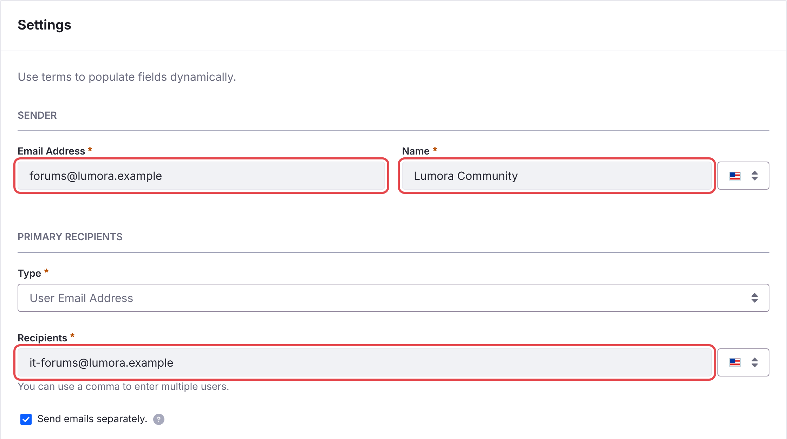

# メール通知 {#email-notifications}

Liferay Forums は、フォローしているトピックへの返信やメンションについて、メンバーにメールを送信します。送信できるようにするには、事前に送信元のアドレスを設定してください。

1. *Applications* → *Notification Templates* で **C2M0 Notification Email Reply** を開き、次のように設定します。
   - **Sender** の **Email Address**：サイトが所有するドメインのアドレス（例：`forums@example.com`）
   - **Sender** の **Name**：メンバーに表示される名前（例：*Example Community*）
   - **Primary Recipients** の **Recipients**：自分が所有するアドレス。メンバーは常に BCC に追加されるため、このアドレスにはコピーが届くだけです。

    次に、**Save** をクリックします。

    {: .screenshot }

1. **C2M0 Notification Email Mention** にも同じ設定をします。

1. *Control Panel* → *Instance Settings* → *Email* → *Email Sender* で、Liferay がメールを送信する際のアドレスを設定します。これを設定しないと、Liferay はメールを送信しません。

1. Liferay のメールサーバーが設定されていることを確認します。

{: .warning }
変更するまで、テンプレートはプレースホルダーのアドレス `forums-noreply@example.xyz` を使用します。メールサーバーは、所有していないドメインからのメールを拒否するか、迷惑メールとして扱います。

{: .note }
この 2 つのテンプレートは batch によって作成され、batch を再度デプロイしても、テンプレートへの変更は保持されます。マイクロサービスは起動時にテンプレートを読み込むため、テンプレートを変更した後はマイクロサービスを再起動してください。

## Web 通知 {#web-notifications}

メンバーには、Liferay の通知メニューにも通知が届きます。これには設定は不要です。

## 関連情報 {#related-information}

- [購読と通知](../using/subscriptions-and-notifications.html)
