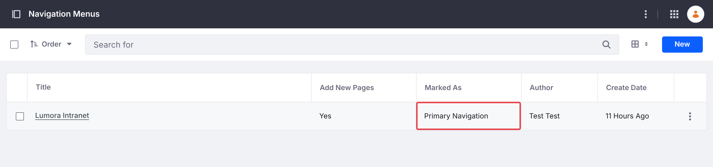
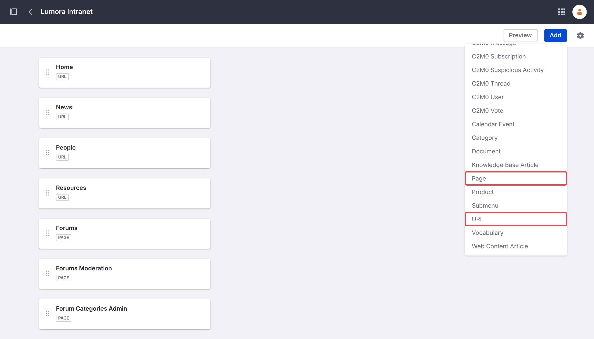
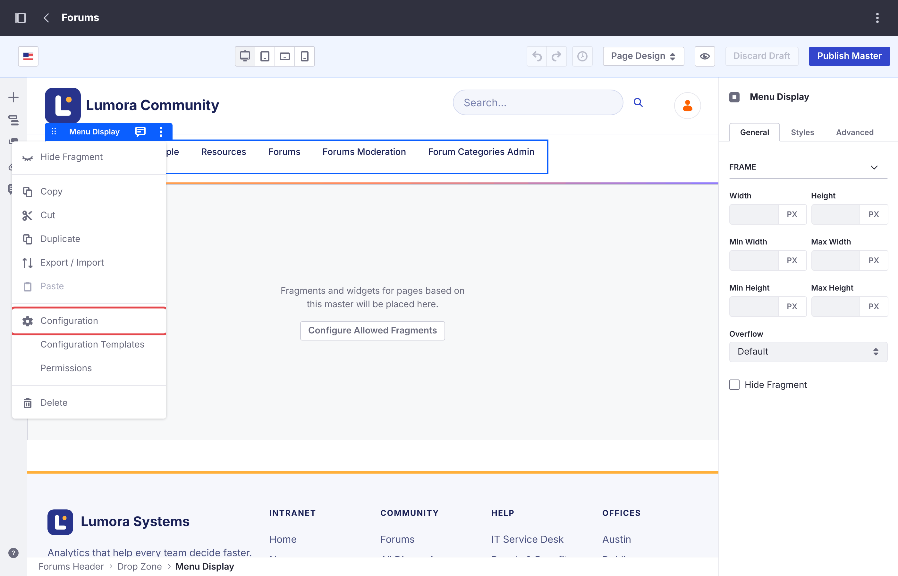
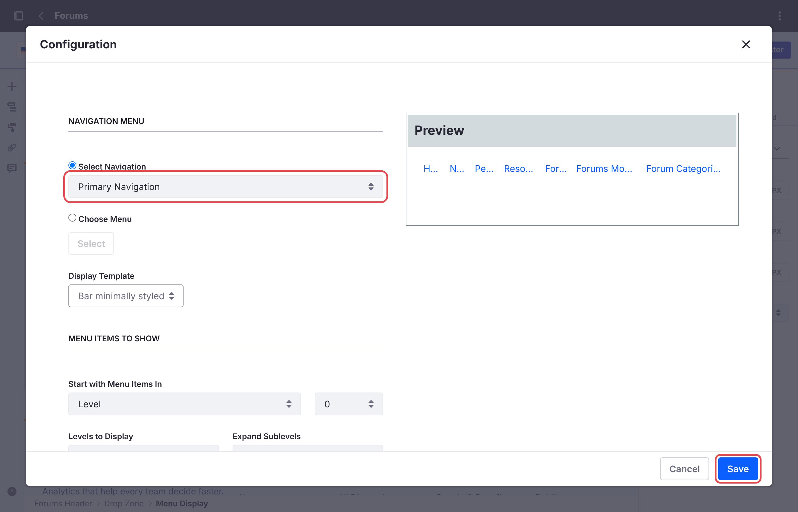

# 複数のフォーラムサイトの運用 {#running-several-forum-sites}

1 つの Liferay インスタンスで、製品ごとや地域ごとなど、複数のフォーラムサイトをホストできます。各サイトは、それぞれ独自のカテゴリー、トピック、検索、禁止（バン）を持ちます。

site initializer が作成するサイトは 1 つなので、サイトごとに専用の site initializer が必要です。すべてのインストール方法の手順は、[複数のサイト](../installing/creating-sites.html#several-sites)にあります。batch とマイクロサービスはすべてのフォーラムサイトで共有され、デプロイは 1 回だけです。

Liferay は各サイトのアドレスをサイト名から作成します。たとえば、*Acme* という名前のサイトは `/web/acme` で公開されます。別のアドレスを使用するには、別の名前を選ぶか、サイトの作成後に *Site Settings* でサイトのフレンドリー URL を変更します。

## モデレーターとカテゴリー管理者 {#moderators-and-category-admins}

禁止は 1 つのサイトに適用されますが、**Forum Moderator** ロールと **Forum Category Admin** ロールはすべてのフォーラムサイトに適用されます。つまり、あるフォーラムサイトのモデレーターは、すべてのフォーラムサイトをモデレートします。[ロールと権限](../reference/roles-and-permissions.html)を参照してください。

## 既存のサイト {#an-existing-site}

Liferay はサイトの作成時にのみフォーラムページを設定するため、すでに存在するサイトにフォーラムを追加することはできません。また、フォーラムサイトは常にトップレベルのサイトであり、別のサイトの子サイトとして作成することはできません。代わりにフォーラムサイトを作成し、2 つのサイトを相互にリンクして、メンバーが 1 つのサイトのように行き来できるようにします。

### 既存のサイトからフォーラムにリンクする {#link-to-the-forum-from-the-existing-site}

既存のサイトで、*Site Builder* → *Pages* に **Link to URL** タイプのページ（例：**Forums**）を追加し、フォーラムサイトのアドレス（例：`/web/forums`）を指すようにします。このページは、既存のサイトのナビゲーションに他のページと同じように表示されます。

### フォーラムサイトから戻るリンクを設定する {#link-back-from-the-forum-site}

フォーラムのヘッダーにはフォーラムサイト自身のページが表示されるため、フォーラムを開いたメンバーには既存のサイトのナビゲーションが表示されなくなります。既存のサイトのページを先頭に並べたナビゲーションメニューをフォーラムサイトに設定します。

1. フォーラムサイトで *Site Builder* → *Navigation Menus* に移動し、メニュー（例：**Main**）を追加します。その設定で、**Primary Navigation** としてマークします。

    {: .screenshot }

1. 既存のサイトのページを、既存のサイトでの表示順に **URL** 項目として追加します。たとえば、`/web/intranet/home` の **Home**、続いて **News** と **People** です。

1. **Add** → **Page** で、フォーラムのページ（**Forums**、続いて **Forums Moderation** と **Forum Categories Admin**）を追加します。ページ項目はそのページの権限を保持するため、メンバーには 2 つのモデレーター用ページは表示されません。

    {: .screenshot }

1. *Design* → *Page Templates* → *Masters* に移動し、**Forums** を開きます。ヘッダーのメニューをクリックしてその **Menu Display** ウィジェットを選択し、オプションメニュー（⋮）から **Configuration** を選択します。

    {: .screenshot }

1. **Select Navigation** を **Primary Navigation** に設定し、**Save** をクリックします。次に、**Publish Master** をクリックします。

    {: .screenshot }

これで、フォーラムのヘッダーに既存のサイトのページが表示され、フォーラムのホームページでは **Forums** が強調表示されます。2 つのサイトの外観も合わせるには、[自社の外観に合わせる](customizing.html#matching-your-companys-look)を参照してください。

{: .note }
この目的には、フォーラムサイトの **Link to URL** ページは使用できません。Liferay ではこのタイプのページをサイトの最初のページにできないため、その方法では既存のサイトのホームページを先頭にすることができません。

## 各サイトでの変更 {#your-changes-on-each-site}

各フォーラムサイトは、それぞれ独自の **Forums** マスターページ、スタイルブック、ナビゲーションメニューを持ちます。[フォーラムのカスタマイズ](customizing.html)のように、あるフォーラムサイトの外観やナビゲーションを変更した場合は、他の各サイトでも同じ変更を行う必要があります。

## フォーラムサイトの削除 {#deleting-a-forum-site}

[フォーラムサイトの削除](../installing/deleting.html)を参照してください。他のフォーラムサイトには影響しません。

## 関連情報 {#related-information}

- [フォーラムのカスタマイズ](customizing.html)
- [はじめに](../getting-started.html)
- [メンバーの禁止](../moderating/banning.html)
