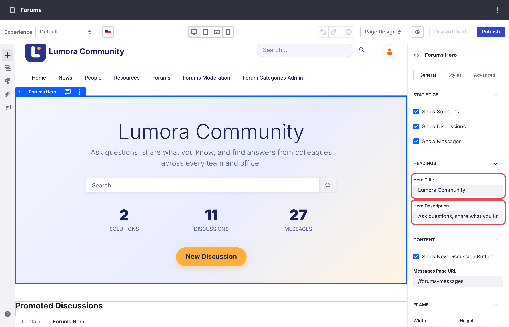
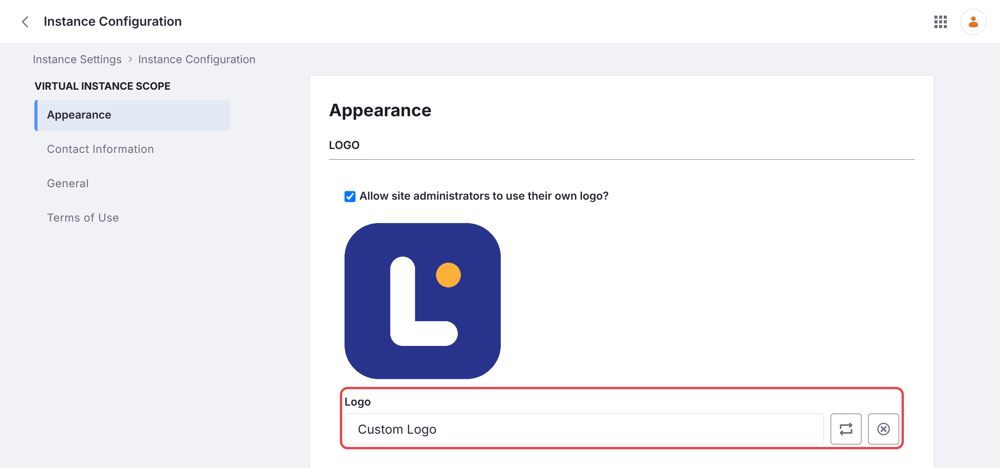
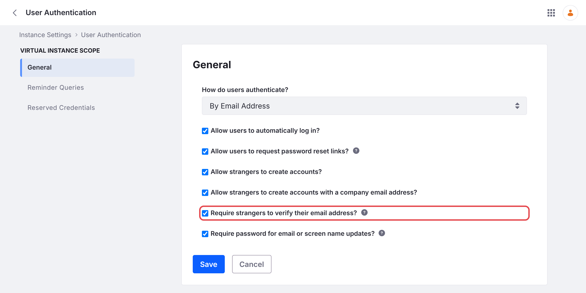
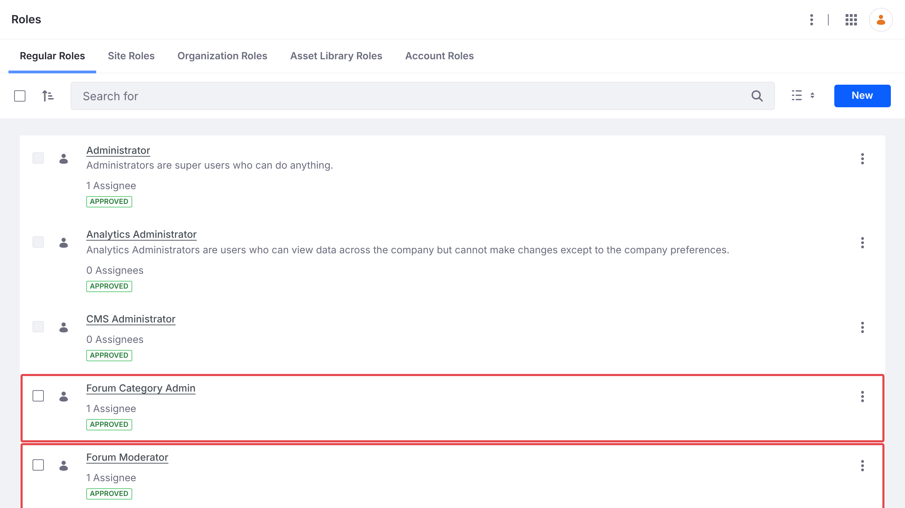
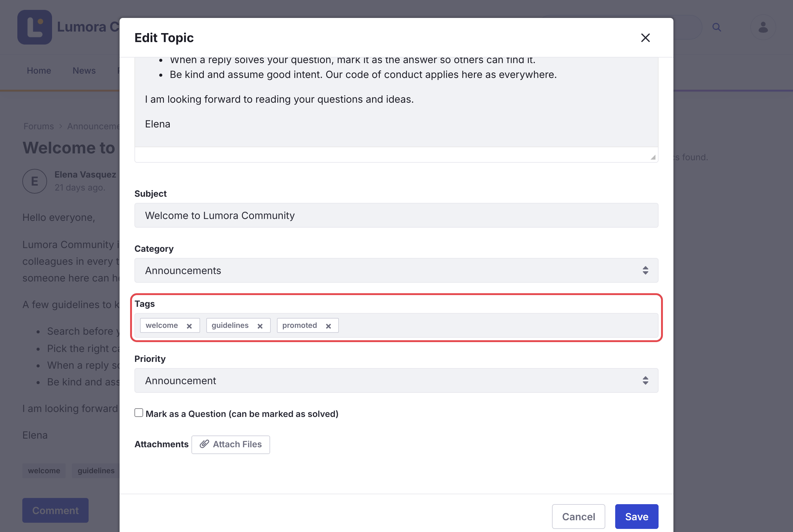

# はじめに {#getting-started}
{: .no_toc }

Liferay Forums は、Liferay DXP に完全なフォーラムサイトを追加します。このページでは、インストールから、メンバーが使えるフォーラムになるまでを説明します。

1. TOC
{:toc}

## インストール {#install}

Liferay Forums 1.0.0 は、[必要な Liferay の修正](installing/#required-liferay-fixes)を適用した Liferay DXP 2026.Q1 LTS で動作します。[インストール](installing/)には、含まれるものの一覧と、Liferay Self-Hosted（Tomcat または Docker）、Liferay PaaS、Liferay SaaS へのインストール手順が記載されています。インストールが完了すると、フォーラムは `/web/forums` で利用できます。

## 初回のセットアップ {#first-time-setup}

インストール後、管理者として次の手順を完了してください。最初の手順が終われば、メンバーは投稿を始められます。

### カテゴリーを作成する {#create-categories}

**Forum Categories Admin** を開き、**Seed Default Categories** をクリックするか、独自のカテゴリーを追加します。カテゴリーが 1 つ以上存在するまで、メンバーは投稿できません。[カテゴリーの管理](administering/categories.html)を参照してください。

{: .screenshot }

### フォーラムに名前を付ける {#name-your-forum}

ホームページのタイトルは、変更するまで **Liferay Forums** と表示されます。

1. フォーラムのホームページ（例: `/web/forums`）を開き、鉛筆アイコンをクリックして編集します。
1. 上部のバナーであるヒーローをクリックします。その **General** 設定の **Headings** で、**Hero Title** と **Hero Description** を設定します。
1. **Publish** をクリックします。

{: .screenshot }

ヘッダーに表示されるサイトの名前は、*Site Settings* で設定します。サイトの名前はアドレスも決めるため、サイト名を変更するには[複数のフォーラムサイトの運営](administering/several-sites.html)を参照してください。

### Liferay のリンクを置き換える {#replace-the-liferay-links}

ヘッダーには、site initializer が追加する 2 つのリンクページ、**Liferay Learn** と **Help Center** へのリンクがあります。*Site Builder* → *Pages* で、これらを削除するか、独自のヘルプページを指すように編集します。

### ロゴを追加する {#add-your-logo}

ヘッダーには、サイトの名前の横に Liferay インスタンスのロゴが表示されます。*Control Panel* → *Instance Settings* → *Instance Configuration* → *Appearance* → **Logo** で設定し、**Save** をクリックします。インスタンスのロゴを表示するすべてのサイトに、新しいロゴが表示されます。

{: .screenshot }

ヘッダーとフッターの色も変更するには、[フォーラムのカスタマイズ](administering/customizing.html)を参照してください。

### メール通知を設定する {#set-up-email-notifications}

フォーラムのメールテンプレートと Liferay インスタンスの送信者アドレスを設定し、マイクロサービスを再起動します。マイクロサービスは起動時にのみテンプレートを読み込みます。[メール通知](administering/email-notifications.html)を参照してください。

### メンバーがサインインできるようにする {#let-members-sign-in}

デフォルトでは、Liferay は、作成またはインポートしたアカウントも含め、すべての新しいアカウントに最初のサインイン時にメールアドレスの確認を求めます。確認が済むまで、メンバーは投稿できません。

- メンバーがシングルサインオンでサインインする場合、またはメンバーのアカウントを管理者が作成する場合は、*Control Panel* → *Instance Settings* → *User Authentication* に移動し、**Require strangers to verify their email address?** のチェックを外して、**Save** をクリックします。
- それ以外の場合は設定をそのままにし、[メール通知を設定する](#set-up-email-notifications)のとおり、先に Liferay がメールを送信できることを確認してください。

{: .screenshot }

### モデレーターを割り当てる {#assign-moderators}

*Control Panel* → *Users* → *Roles* で **Forum Moderator** をクリックし、**Assignees** → **Users** を開いて **New** をクリックし、モデレートを担当する人を追加します。カテゴリーを管理する人については、**Forum Category Admin** で同じ操作を行います。どちらのロールもすべてのフォーラムサイトに適用されます。[ロールと権限](reference/roles-and-permissions.html)を参照してください。

{: .screenshot }

### ウェルカムトピックを投稿してプロモートする {#post-a-welcome-topic-and-promote-it}

1. [ディスカッションの開始](using/starting-a-discussion.html)のとおり、**New Discussion** を使ってコミュニティガイドラインを投稿します。
1. モデレーターとしてトピックを開き、**Options** → **Edit Topic** を選択します。
1. タグ `promoted` を追加し、**Priority** を **Announcement** に設定して、**Save** をクリックします。

{: .screenshot }

ホームページの **Promoted Discussions** には、`promoted` タグが付いたトピックが表示されます。このタグが付いたトピックが 1 つもない間は、内容にかかわらず最近変更されたトピックが代わりに表示されます。そのため、フォーラムを告知する前に、ガイドラインやハウツーなど 2、3 のトピックをプロモートしておいてください。

## 関連トピック {#related-topics}

- [インストール](installing/)
- [ディスカッションの開始](using/starting-a-discussion.html)
- [ロールと権限](reference/roles-and-permissions.html)
- [複数のフォーラムサイトの運用](administering/several-sites.html)