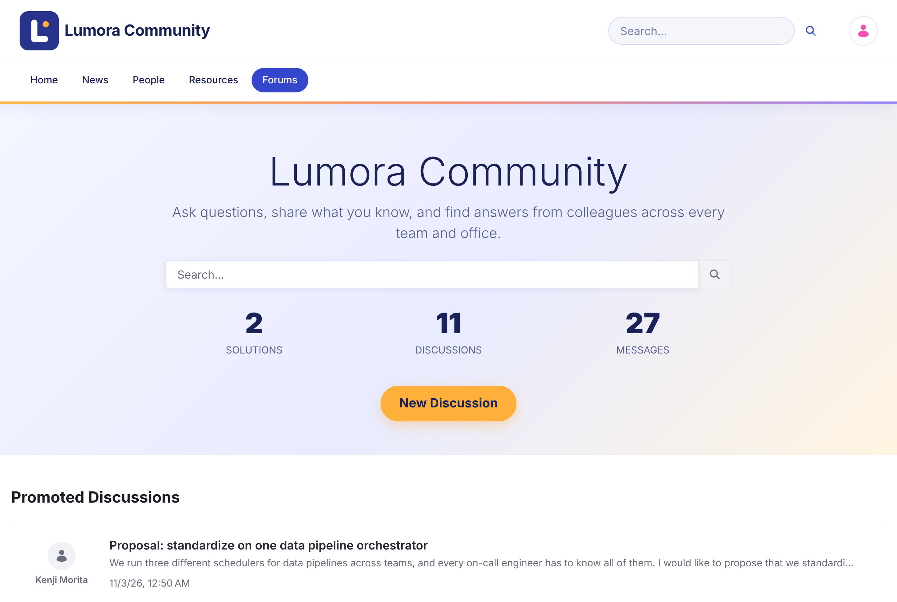

# Liferay Forums {#liferay-forums}
{: .no_toc }

Liferay DXP のためのモダンなディスカッションフォーラムです。メンバーは質問をしたり、回答を共有したり、関心のある会話をフォローしたりでき、モデレーターはコミュニティを健全に保ちます。

{: .screenshot }

  <a class="card doc" href="getting-started.html"><strong>はじめに</strong>Liferay Forums に含まれるものと、最初のフォーラムサイトのセットアップ方法。</a>
  <a class="card doc" href="installing/"><strong>インストール</strong>Liferay Self-Hosted（Tomcat または Docker）、Liferay PaaS、または SaaS への手順ごとのインストール。</a>
  <a class="card doc" href="using/"><strong>フォーラムの使い方</strong>ディスカッションの開始、返信、質問、投票、トピックのフォロー。</a>
  <a class="card doc" href="moderating/"><strong>モデレーション</strong>トピックのロック、報告のレビュー、ルールに違反したメンバーの禁止。</a>
  <a class="card doc" href="administering/"><strong>管理</strong>カテゴリー、メール通知、サイトの外観、複数のフォーラムサイトの管理。</a>
  <a class="card doc" href="reference/"><strong>リファレンス</strong>ロールと権限、ページ、設定、既知の問題。</a>

## 主な機能 {#highlights}

- **ディスカッションと質問。** トピックは、オープンなディスカッションとして、または解決済みにできる質問として投稿できます。
- **カテゴリー。** トピックをカテゴリーと 1 階層のサブカテゴリーに整理できます。
- **メンションと購読。** `@` でメンバーにメンションでき、フォローしているトピックについて Web 通知とメール通知を受け取れます。
- **投票。** トピックや返信に賛成票または反対票を投じることができます。
- **モデレーション。** メンバーがコンテンツを報告します。モデレーターは、サイトごとに報告の承認、トピックのロック、トピックの削除、投稿者の禁止を行います。
- **検索。** カテゴリー、タグ、投稿者、日付のファセットでトピックを検索できます。
- **複数のサイト。** それぞれ独自のカテゴリー、トピック、禁止設定を持つ、別々のフォーラムを運営できます。
- **13 の言語。** ラベルは、英語、アラビア語、カタロニア語、中国語、オランダ語、フィンランド語、フランス語、ドイツ語、ハンガリー語、日本語、ポルトガル語（ブラジル）、スペイン語、スウェーデン語で提供されます。

## 対応バージョン {#supported-versions}

| Liferay Forums | Liferay DXP |
| --- | --- |
| [1.0.0](https://github.com/Liferay-Community-APAC/liferay-forums/releases/tag/v1.0.0) | 2026.Q1 LTS（[必要な Liferay の修正](installing/#required-liferay-fixes)を適用したもの）。2026.Q1.1 と 2026.Q1.4 でテスト済みです。 |

Liferay Forums をインストールするには、[インストール](installing/)の手順に従ってください。リリースファイルは[最新のリリース](https://github.com/Liferay-Community-APAC/liferay-forums/releases/latest)からダウンロードします。

## ソリューションレシピ {#solution-recipes}

レシピでは、Liferay Forums をほかの Liferay 製品と組み合わせる方法を手順を追って説明します。レシピは Liferay Community APAC サイトにあります（英語）。

  <a class="card doc" href="https://liferay-community-apac.github.io/solution-recipes/forums-ai-assistant/"><strong>Forums Assistant with AI Hub</strong>メンバーが探しているディスカッションの場所を教える AI チャットを追加します。検索するのは、各メンバーが閲覧できる内容だけです。ベータ版の Liferay AI Hub を使用します。</a>

  
  
<strong>Liferay AI Hub で構築。</strong>Liferay AI Hub を使うと、学習して判断し、デジタルエクスペリエンスを向上させる AI エージェントを、技術的な障壁なしに展開できます。 <a href="https://www.liferay.co.jp/capabilities/ai-hub">Liferay AI Hub の詳細を見る</a>

