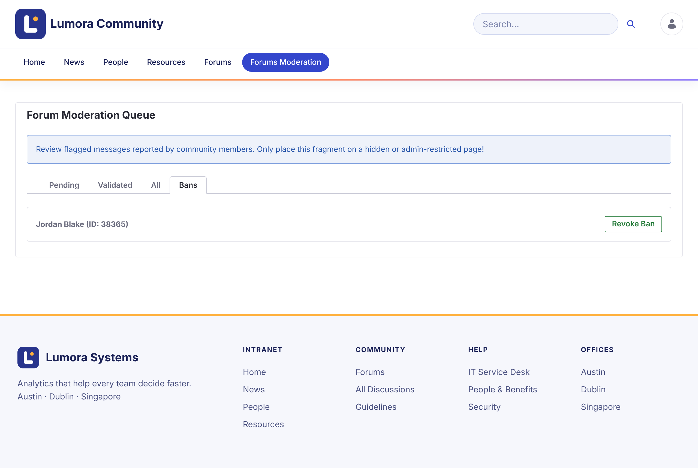

# メンバーの禁止 {#banning-members}

禁止されたメンバーは、フォーラムを閲覧することはできますが、トピックの開始や返信はできません。既存の投稿はそのまま残ります。投稿しようとすると、**Your account has been banned from participating in the forums.** と表示されます。

## メンバーを禁止する {#banning-a-member}

1. モデレーションキューで、**Validated** タブを開きます。

1. そのメンバーのトピックに対する報告で、**Ban Author** をクリックします。

1. 確定します。

メンバーは **Bans** タブに表示されます。

{: .screenshot }

禁止は 1 つのサイトに適用されます。あるフォーラムサイトで禁止されたメンバーも、別のフォーラムサイトには投稿できます。

{: .note }
禁止は、サイトロール **Forum Banned** です。管理者は、サイトのメンバーシップでメンバーにこのロールを割り当てることもできます。

## 禁止を解除する {#lifting-a-ban}

**Bans** タブで、メンバーの横にある **Revoke Ban** をクリックします。

## 関連情報 {#related-information}

- [報告のレビュー](reviewing-reports.html)
- [ロールと権限](../reference/roles-and-permissions.html)
