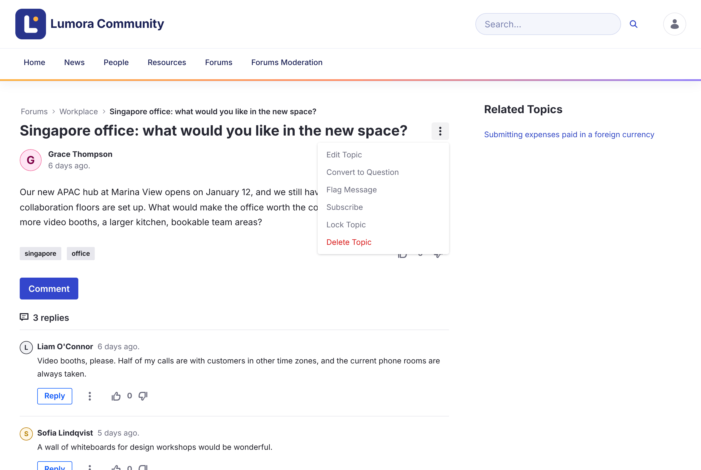

# モデレーション {#moderating}

モデレーターは、ディスカッションが話題から外れないようにし、コミュニティからの報告に対応します。

{: .important }
モデレーションには、**Forum Moderator** ロール、または Liferay の **Administrator** ロールが必要です。モデレーターには、フォーラムのナビゲーションに **Forums Moderation** ページが表示され、各トピックの **Options** メニューにモデレーションのアクションが表示されます。[ロールと権限](../reference/roles-and-permissions.html)を参照してください。

{: .screenshot }

  <a class="card doc" href="locking.html"><strong>トピックのロック</strong>トピックへの新しい返信と編集を停止します。</a>
  <a class="card doc" href="priority.html"><strong>優先度によるトピックの固定</strong>お知らせや重要なトピックを上部に表示し続けます。</a>
  <a class="card doc" href="reviewing-reports.html"><strong>報告のレビュー</strong>メンバーからの報告を承認または却下します。</a>
  <a class="card doc" href="banning.html"><strong>メンバーの禁止</strong>メンバーがサイトに投稿できないようにします。</a>

