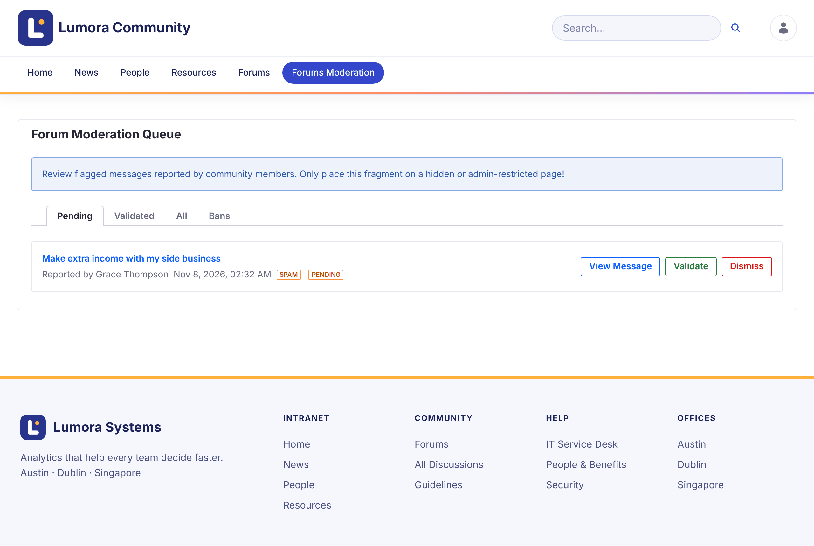
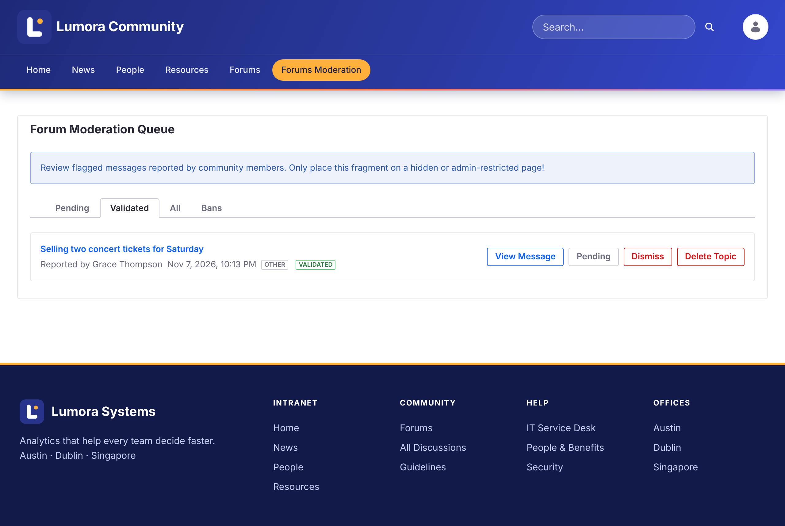

# 報告のレビュー {#reviewing-reports}
{: .no_toc }

メンバーがトピックを[報告](../using/reporting.html)すると、その報告はモデレーションキューに表示されます。

1. TOC
{:toc}

## モデレーションキュー {#the-moderation-queue}

フォーラムのナビゲーションで **Forums Moderation** を開きます。**Forum Moderation Queue** には 4 つのタブがあります。

| タブ | 表示内容 |
| --- | --- |
| **Pending** | レビュー待ちの新しい報告 |
| **Validated** | モデレーターが承認した報告 |
| **All** | すべての報告 |
| **Bans** | このサイトで禁止されたメンバー |

各報告には、トピック、報告した人、報告日時、理由が表示されます。

{: .screenshot }

## 報告に対応する {#acting-on-a-report}

- **View Message** は、トピックを開いて前後の流れの中で読めるようにします。
- **Validate** は、報告を承認します。同じトピックに対する他の保留中の報告もすべて承認されます。トピックには **Flagged** バッジと、不適切として報告されたことを示すお知らせが付きます。
- **Dismiss** は、報告を削除し、トピックはそのまま残します。

承認された報告では、さらに次のアクションを実行できます。

- **Pending** は、誤って承認した場合に、報告を Pending に戻します。
- **Ban Author** は、トピックの投稿者をこのサイトから禁止します。[メンバーの禁止](banning.html)を参照してください。
- **Delete Topic** は、トピックをそのすべての返信、報告、購読とともに削除します。

{: .screenshot }

{: .warning }
トピックの削除は元に戻せません。

## 関連情報 {#related-information}

- [メンバーの禁止](banning.html)
- [トピックのロック](locking.html)
