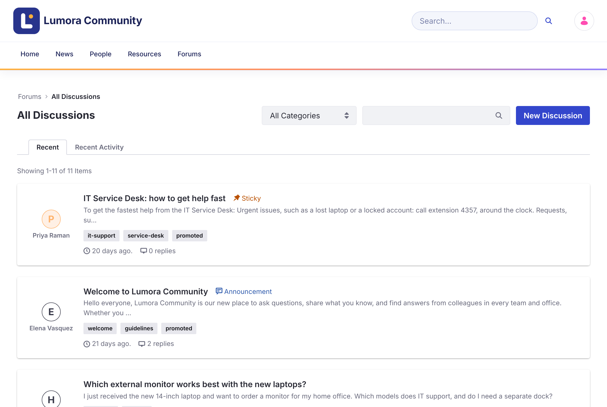
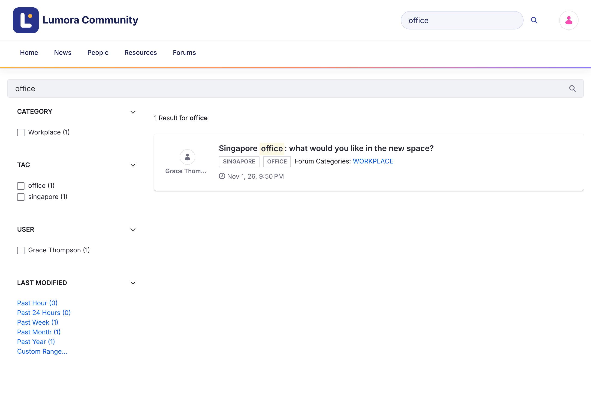

# 閲覧と検索 {#browsing-and-searching}
{: .no_toc }

1. TOC
{:toc}

## フォーラムのホームページ {#the-forum-home-page}

ホームページ（`/web/forums`）には、コミュニティの統計（解決策、ディスカッション、メッセージ）、検索バー、コミュニティチームが選んだ **Promoted Discussions**、カテゴリーのグリッドが表示されます。カテゴリーをクリックすると、そのトピックが表示されます。

## すべてのディスカッション {#all-discussions}

ディスカッションの一覧には、すべてのトピック、または 1 つのカテゴリーのトピックが表示されます。

{: .screenshot }

- **Recent** は、トピックを作成日時の順に並べます。**Recent Activity** は、最新の返信の順に並べます。
- 優先度（**Urgent**、**Sticky**、**Announcement**）が設定されたトピックは、常に最初に表示されます。
- **All Categories** メニューを使うと、1 つのカテゴリーとそのサブカテゴリーを表示できます。
- 検索ボックスを使って一覧をキーワードで絞り込むか、タグをクリックしてそのタグが付いたトピックを表示します。
- バッジはトピックの状態（**Solved**、**Locked**、**Flagged**）と優先度を示します。

## 検索 {#search}

ヘッダーとホームページの検索バーで、フォーラムのトピックを検索できます。検索結果ページには、**Category**、**Tag**、**User**、**Modified** の日付で結果を絞り込むファセットがあります。

{: .screenshot }

検索の対象は、現在のフォーラムサイトのトピックだけです。

## 関連トピック {#related-topics}

トピックページには **Related Topics** が表示されます。これは同じカテゴリーの他のトピックで、最新のアクティビティがあるものから順に並びます。

## 関連情報 {#related-information}

- [ディスカッションの開始](starting-a-discussion.html)
- [カテゴリーの管理](../administering/categories.html)
