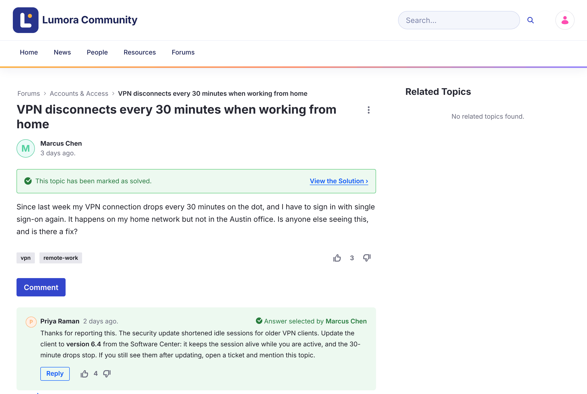

# 質問と回答 {#questions-and-answers}

質問として投稿したトピックは、返信の 1 つを回答として承認することで、解決済みにできます。

{: .screenshot }

## 回答をマークする {#marking-the-answer}

1. 質問を開きます。

1. 質問を解決した返信の下で、**Mark as Answer** をクリックします。

返信には **Accepted** と表示され、トピックには **This topic has been marked as solved.** と **View the Solution** リンクが表示されます。また、一覧ではトピックに **Solved** バッジが付きます。ホームページでは **Solutions** に数えられます。

- 承認された回答にできる返信は 1 つだけです。別の返信を選ぶには、先に **Accepted** をクリックして解除します。
- 承認できるのはトップレベルの返信だけで、返信への返信は承認できません。
- モデレーターも回答をマークしたり解除したりできます。

{: .important }
Liferay Forums 1.0.0 では、質問の投稿者にも **Mark as Answer** が表示されますが、まだ使用できません。[既知の問題](../reference/known-issues.html)を参照してください。

## 関連情報 {#related-information}

- [ディスカッションの開始](starting-a-discussion.html)
- [投票](voting.html)
