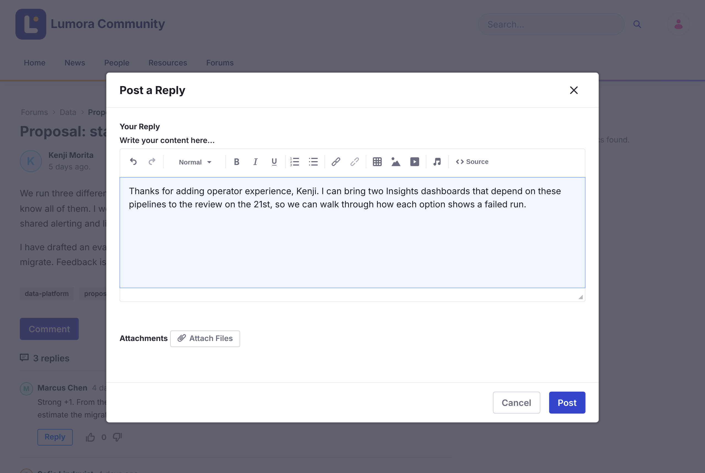

# 返信とメンション {#replying-and-mentions}
{: .no_toc }

1. TOC
{:toc}

## トピックに返信する {#replying-to-a-topic}

1. トピックを開きます。

1. トピックに返信するには **Comment** を、返信に直接答えるにはその返信の下の **Reply** をクリックします。

1. **Your Reply** に返信を書き、必要に応じて **Attach Files** をクリックします。

1. **Post** をクリックします。

{: .screenshot }

返信への返信は、その返信の下にネストされます。長い会話は複数のページに分割されます。

返信を変更または削除するには、その **Options** メニュー（⋮）を開き、**Edit Reply** または **Delete Reply** をクリックします。

{: .note }
[ロックされた](../moderating/locking.html)トピックには返信できません。

## メンションする {#mentioning-someone}

`@` に続けて名前の先頭を入力し、一覧から相手を選びます。相手には Liferay とメールで通知が届きます。

- 一覧には、このフォーラムにすでに投稿したことのある人が表示されます。
- トピックをフォローしているために返信の通知をすでに受け取る人には、メンションの通知は重ねて届きません。
- 返信を編集した場合、新しく追加したメンションだけが通知されます。

## 関連情報 {#related-information}

- [購読と通知](subscriptions-and-notifications.html)
- [投票](voting.html)
