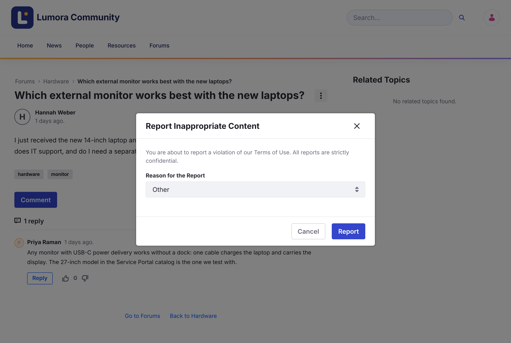

# コンテンツの報告 {#reporting-content}

トピックがコミュニティのルールに違反している場合は、モデレーターがレビューできるように報告してください。

1. トピックを開きます。

1. トピックの **Options** メニュー（⋮）を開き、**Flag Message** をクリックします。

1. **Reason for the Report** を選びます: **Spam**、**Harmful Dangerous Acts**、**Harassment or Bullying**、**Nudity or Sexual Content**、または **Other**。

1. **Report** をクリックします。

{: .screenshot }

報告は非公開です。誰がトピックを報告したかは、モデレーターにしか見えません。1 つのトピックを報告できるのは 1 回だけです。

モデレーターが報告を承認すると、トピックに **This message has been flagged and validated as inappropriate content.** と表示されます。

## 関連情報 {#related-information}

- [報告のレビュー](../moderating/reviewing-reports.html)
