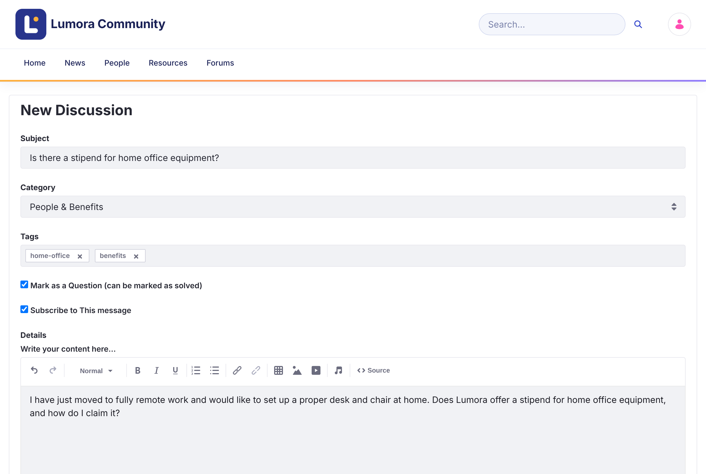

# ディスカッションの開始 {#starting-a-discussion}

トピックは、1 つのカテゴリーで会話を始めるものです。オープンなディスカッションとして、または質問として投稿できます。

{: .important }
ディスカッションを開始するには、サインインしている必要があります。[禁止された](../moderating/banning.html)メンバーは投稿できません。

1. ホームページ、またはディスカッションの一覧の上にある **New Discussion** をクリックします。

1. トピックの内容がわかる **Subject** を入力します。

1. **Category** を選択します。

1. 必要に応じて、他の人がトピックを見つけやすいように **Tags** を追加します。

1. 助けを求める場合は、**Mark as a Question (can be marked as solved)** をチェックしたままにします。オープンなディスカッションにする場合はチェックを外します。これは後から変更できます。

1. 返信の通知を受け取るには、**Subscribe to This message** をチェックしたままにします。

1. **Details** にトピックを書きます。テキストの書式設定、リンク、表、画像、動画の追加、他のメンバーへの[メンション](replying.html#mentioning-someone)ができます。

1. 必要に応じて、**Attach Files** をクリックします。各ファイルは最大 10 MB までです。

1. **Post** をクリックします。

{: .screenshot }

投稿すると、トピックが開きます。

{: .note }
モデレーターには **Priority** フィールド（**Announcement**、**Sticky**、**Urgent**）も表示されます。[優先度によるトピックの固定](../moderating/priority.html)を参照してください。

## トピックを編集または削除する {#editing-or-deleting-your-topic}

トピックの **Options** メニュー（⋮）を開き、**Edit Topic** または **Delete Topic** をクリックします。同じメニューの **Convert to Question** と **Convert to Discussion** で、2 種類のトピックを切り替えられます。

{: .warning }
質問をディスカッションに変換すると、承認された回答が削除されます。

## 関連情報 {#related-information}

- [質問と回答](questions-and-answers.html)
- [返信とメンション](replying.html)
