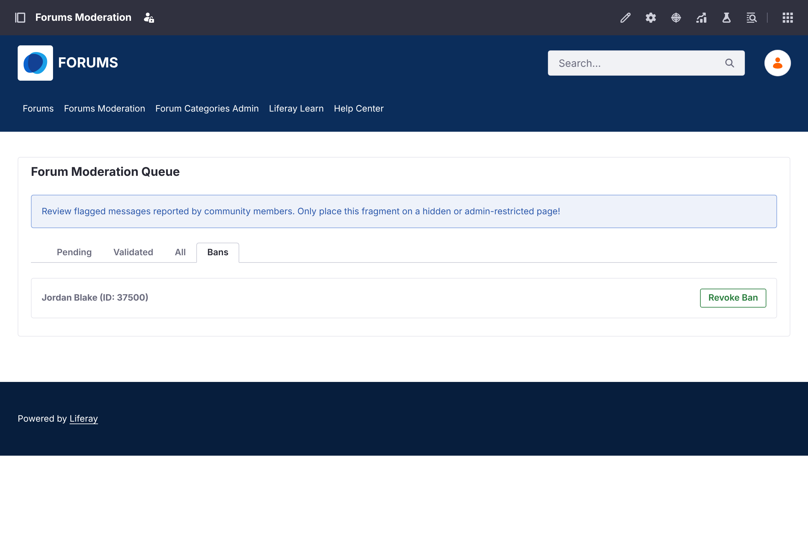

# Banning Members

A banned member can still read the forum, but can't start topics or reply. Their existing posts stay. When they try to post, they see **Your account has been banned from participating in the forums.**

## Banning a Member

1. In the moderation queue, open the **Validated** tab.

1. On a report of the member's topic, click **Ban Author**.

1. Confirm.

The member is listed on the **Bans** tab.

{: .screenshot }

A ban applies to one site. A member banned on one forum site can still post on another.

{: .note }
A ban is the site role **Forum Banned**. Administrators can also assign it to a member in the site's memberships.

## Lifting a Ban

On the **Bans** tab, click **Revoke Ban** next to the member.

## Related Information

- [Reviewing Reports](reviewing-reports.html)
- [Roles and Permissions](../reference/roles-and-permissions.html)
