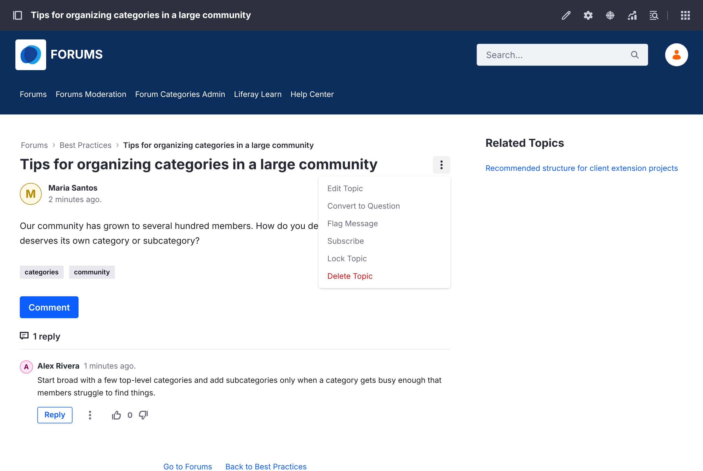

# Moderating

Moderators keep discussions on topic and act on reports from the community.

{: .important }
Moderation needs the **Forum Moderator** role, or Liferay's **Administrator** role. Moderators see the **Forums Moderation** page in the forum's navigation, and moderation actions in each topic's **Options** menu. See [Roles and Permissions](../reference/roles-and-permissions.html).

{: .screenshot }

  <a class="card doc" href="locking.html"><strong>Locking Topics</strong>Stop new replies and edits on a topic.</a>
  <a class="card doc" href="priority.html"><strong>Pinning Topics with Priority</strong>Keep announcements and key topics at the top.</a>
  <a class="card doc" href="reviewing-reports.html"><strong>Reviewing Reports</strong>Validate or dismiss what members report.</a>
  <a class="card doc" href="banning.html"><strong>Banning Members</strong>Stop a member from posting on a site.</a>

