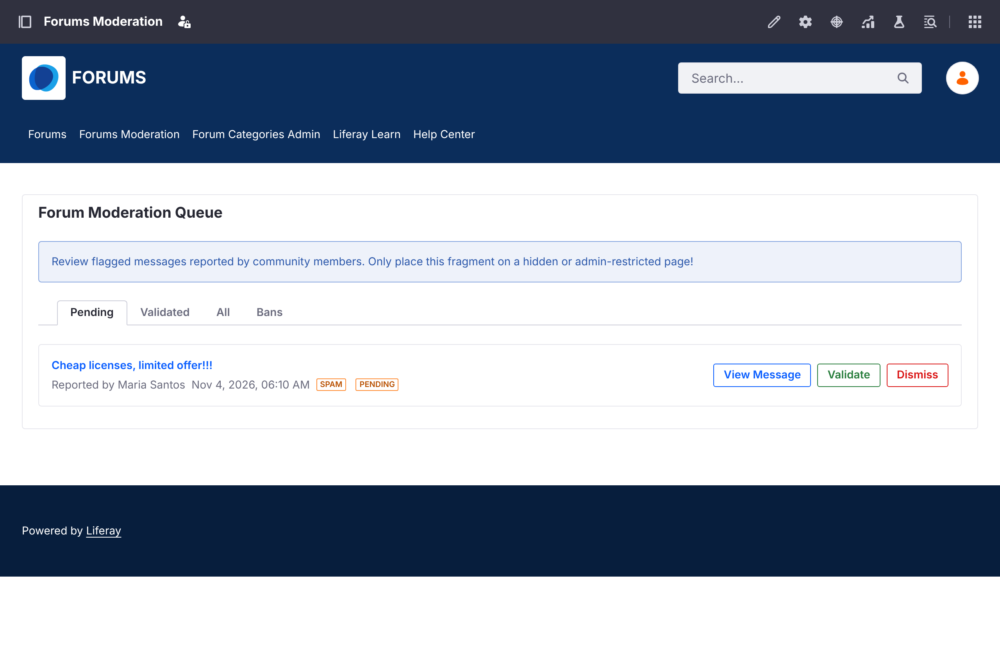
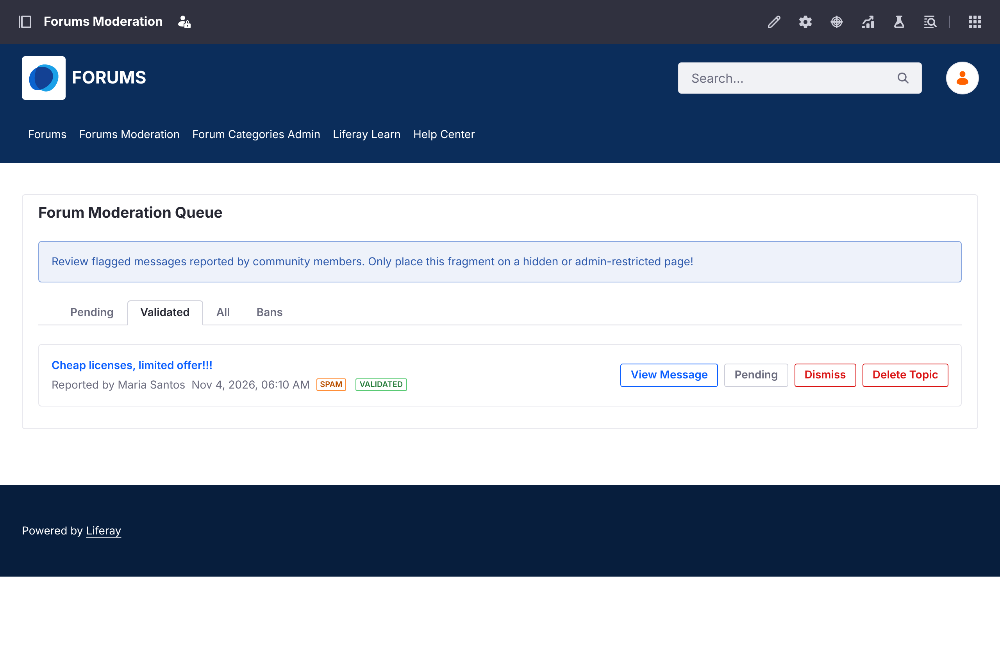

# Reviewing Reports
{: .no_toc }

When members [report](../using/reporting.html) a topic, the report appears in the moderation queue.

1. TOC
{:toc}

## The Moderation Queue

Open **Forums Moderation** in the forum's navigation. The **Forum Moderation Queue** has four tabs:

| Tab | Shows |
| --- | --- |
| **Pending** | New reports to review |
| **Validated** | Reports a moderator confirmed |
| **All** | Every report |
| **Bans** | Members banned on this site |

Each report shows the topic, who reported it, when, and the reason.

{: .screenshot }

## Acting on a Report

- **View Message** opens the topic so you can read it in context.
- **Validate** confirms the report. All other pending reports on the same topic are validated too. The topic gets the **Flagged** badge and a notice that it was flagged as inappropriate.
- **Dismiss** deletes the report and keeps the topic as it is.

A validated report offers more actions:

- **Pending** moves the report back to Pending, if it was validated by mistake.
- **Ban Author** bans the topic's author from this site. See [Banning Members](banning.html).
- **Delete Topic** deletes the topic with all its replies, reports, and subscriptions.

{: .screenshot }

{: .warning }
Deleting a topic can't be undone.

## Related Information

- [Banning Members](banning.html)
- [Locking Topics](locking.html)
