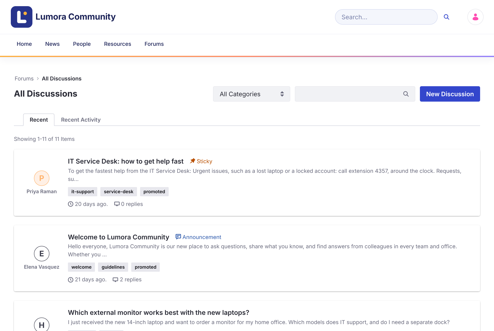
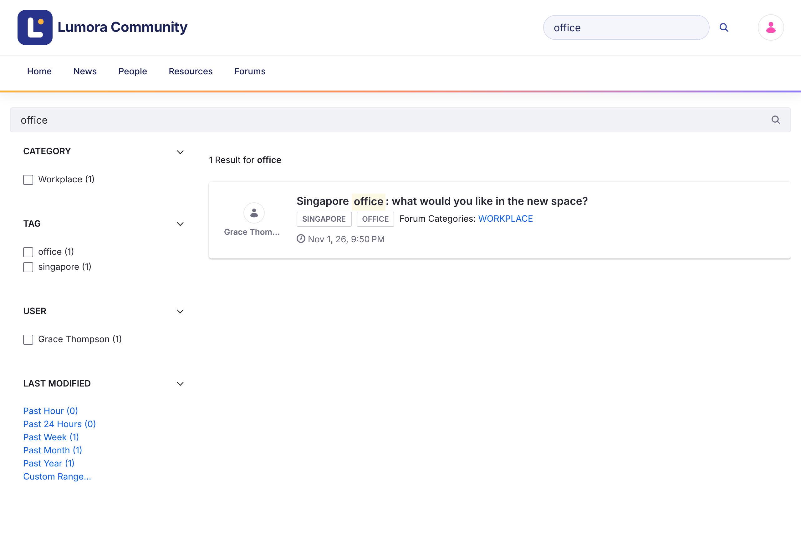

# Browsing and Searching
{: .no_toc }

1. TOC
{:toc}

## The Forum Home Page

The home page (`/web/forums`) shows community statistics (solutions, discussions, and messages), a search bar, the **Promoted Discussions** chosen by the community team, and a grid of categories. Click a category to see its topics.

## All Discussions

The discussions list shows every topic, or the topics of one category.

{: .screenshot }

- **Recent** sorts topics by when they were created. **Recent Activity** sorts them by their latest reply.
- Topics with a priority (**Urgent**, **Sticky**, or **Announcement**) always appear first.
- Use the **All Categories** menu to show one category and its subcategories.
- Use the search box to filter the list by keyword, or click a tag to show the topics with that tag.
- Badges show a topic's state: **Solved**, **Locked**, **Flagged**, and its priority.

## Search

The search bar in the header and on the home page searches the forum's topics. The results page has facets to narrow results by **Category**, **Tag**, **User**, and **Modified** date.

{: .screenshot }

Search only covers the topics of the current forum site.

## Related Topics

A topic page lists **Related Topics**: other topics in the same category, with the most recent activity first.

## Related Information

- [Starting a Discussion](starting-a-discussion.html)
- [Managing Categories](../administering/categories.html)
- [Forums Assistant with AI Hub](https://liferay-community-apac.github.io/solution-recipes/forums-ai-assistant/), a solution recipe
