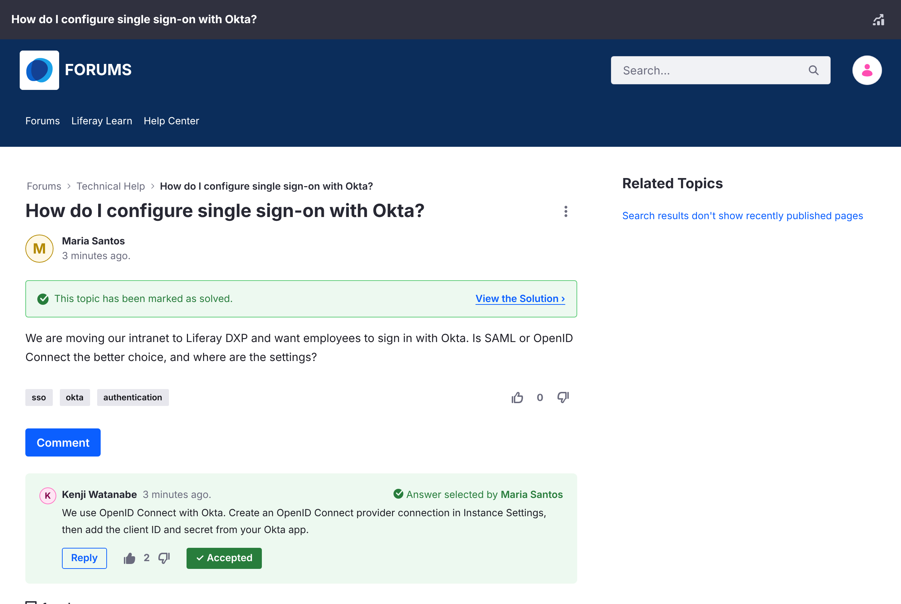

# Questions and Answers

A topic posted as a question can be marked as solved by accepting one reply as its answer.

{: .screenshot }

## Marking the Answer

1. Open the question.

1. Under the reply that solves it, click **Mark as Answer**.

The reply shows **Accepted**, the topic shows **This topic has been marked as solved.** with a **View the Solution** link, and the topic gets the **Solved** badge in lists. The home page counts it under **Solutions**.

- Only one reply can be the accepted answer. To choose another, click **Accepted** to clear it first.
- Only top-level replies can be accepted, not replies to replies.
- Moderators can mark and clear the answer.

{: .important }
In Liferay Forums 1.0.0, the question's author also sees **Mark as Answer**, but can't use it yet. See [Known Issues](../reference/known-issues.html).

## Related Information

- [Starting a Discussion](starting-a-discussion.html)
- [Voting](voting.html)
