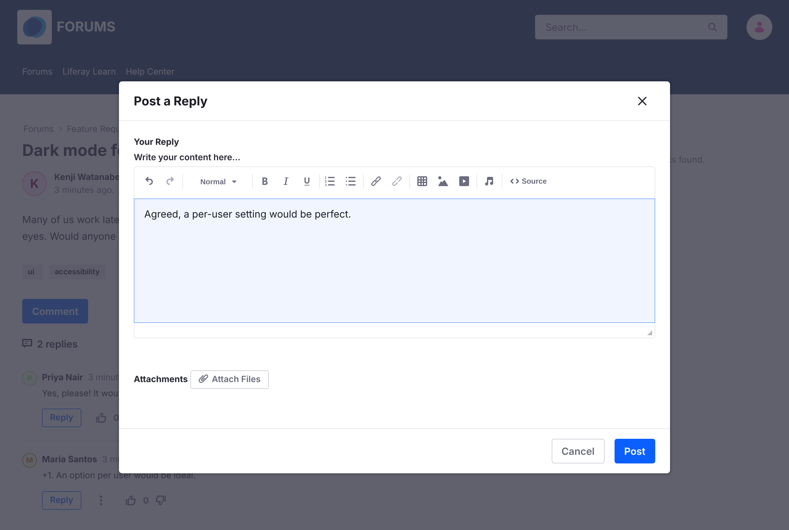

# Replying and Mentions
{: .no_toc }

1. TOC
{:toc}

## Replying to a Topic

1. Open the topic.

1. Click **Comment** to reply to the topic, or **Reply** under a reply to answer it directly.

1. Write your reply in **Your Reply**, and optionally click **Attach Files**.

1. Click **Post**.

{: .screenshot }

Replies to a reply are nested under it. Long conversations are split into pages.

To change or remove your reply, open its **Options** menu (⋮) and click **Edit Reply** or **Delete Reply**.

{: .note }
You can't reply to a [locked](../moderating/locking.html) topic.

## Mentioning Someone

Type `@` followed by the start of a name, and choose the person from the list. They get a notification in Liferay and by email.

- The list shows people who have already posted in this forum.
- If someone is already notified about your reply because they follow the topic, they don't get a second notification for the mention.
- When you edit a reply, only newly added mentions are notified.

## Related Information

- [Subscriptions and Notifications](subscriptions-and-notifications.html)
- [Voting](voting.html)
