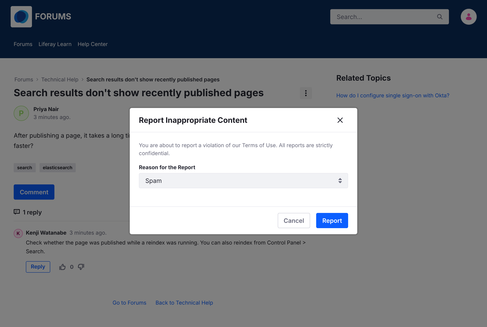

# Reporting Content

If a topic breaks the community rules, report it so a moderator can review it.

1. Open the topic.

1. Open the topic's **Options** menu (⋮) and click **Flag Message**.

1. Choose a **Reason for the Report**: **Spam**, **Harmful Dangerous Acts**, **Harassment or Bullying**, **Nudity or Sexual Content**, or **Other**.

1. Click **Report**.

{: .screenshot }

Reports are confidential: only moderators see who reported a topic. You can report a topic once.

When a moderator confirms a report, the topic shows **This message has been flagged and validated as inappropriate content.**

## Related Information

- [Reviewing Reports](../moderating/reviewing-reports.html)
