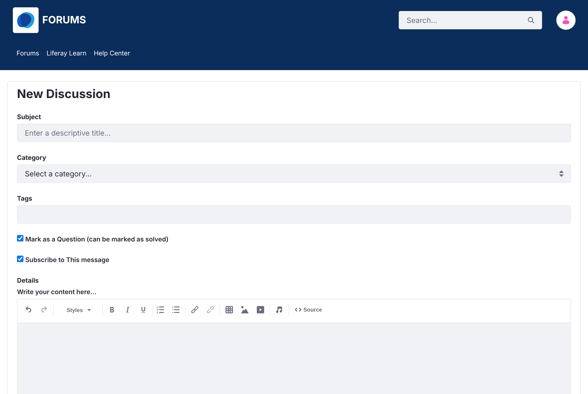

# Starting a Discussion

A topic starts a conversation in one category. You can post it as an open discussion or as a question.

{: .important }
You must be signed in to start a discussion. Members who are [banned](../moderating/banning.html) can't post.

1. Click **New Discussion** on the home page or above the discussions list.

1. Enter a **Subject** that describes the topic.

1. Select a **Category**.

1. Optionally, add **Tags** to help others find the topic.

1. Leave **Mark as a Question (can be marked as solved)** checked if you're asking for help. Clear it for an open discussion. You can change this later.

1. Leave **Subscribe to This message** checked to get notified about replies.

1. Write the topic in **Details**. You can format text, add links, tables, images, and video, and [mention](replying.html#mentioning-someone) other members.

1. Optionally, click **Attach Files**. Each file can be up to 10 MB.

1. Click **Post**.

{: .screenshot }

The topic opens when it's posted.

{: .note }
Moderators also see a **Priority** field: **Announcement**, **Sticky**, or **Urgent**. See [Pinning Topics with Priority](../moderating/priority.html).

## Editing or Deleting Your Topic

Open the topic's **Options** menu (⋮) and click **Edit Topic** or **Delete Topic**. From the same menu, **Convert to Question** and **Convert to Discussion** switch between the two kinds of topic.

{: .warning }
Converting a question to a discussion removes its accepted answer.

## Related Information

- [Questions and Answers](questions-and-answers.html)
- [Replying and Mentions](replying.html)
